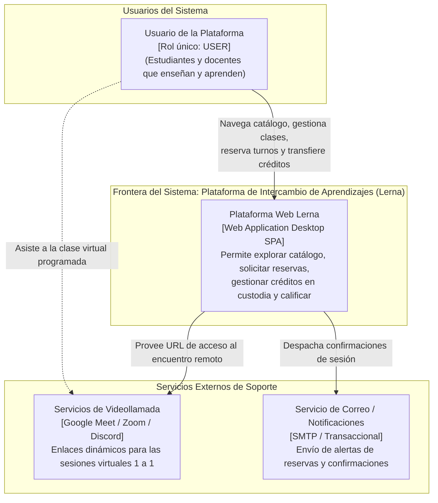
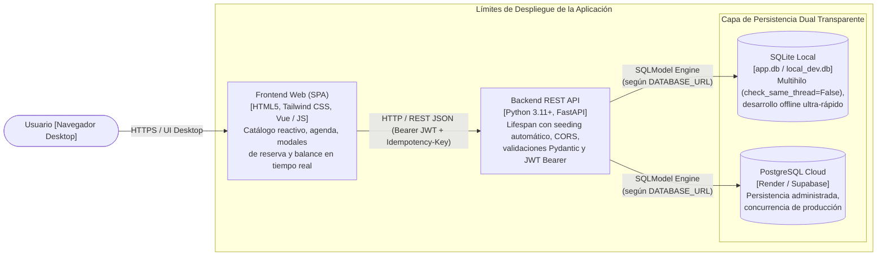

# 4.3.16 Confeccionar el diagrama de arquitectura técnica

> **Materia:** Gestión del Desarrollo de Sistemas Informáticos (FIUBA - Código TC017)  
> **Proyecto:** Plataforma Web de Intercambio de Aprendizajes y Habilidades (Lerna)  
> **Entregable:** Sección 4.3 Segundo: Design Thinking / Construcción – Ítem 4.3.16  
> **Diapositiva interactiva para defensa oral:** [arquitectura-slide.html](file:///c:/develop/95.24/proyecto-wbs/docs/Entrega/arquitectura-slide.html)

---

## 1. Propósito y Enfoque Metodológico

El presente documento formaliza la **arquitectura técnica real y fidedigna de software** de la **Plataforma de Intercambio de Aprendizajes (Lerna)**, correspondiente al entregable **`4.3.16`** de la WBS. Su objetivo es proporcionar una visión estructural exhaustiva, modular y desacoplada del sistema, fiel a la implementación concreta en Python (FastAPI + SQLModel) y al cliente web desktop.

### Restricciones Arquitectónicas de Dominio Aprobadas:
1. **Rol único de usuario (`USER`):** Entidad transversal en base de datos (`app.models.user.User`) con capacidad dual para ofrecer conocimientos (`Offer`) o registrar necesidades (`Need`) indistintamente.
2. **Mecanismo de créditos virtuales no monetarios:** Contabilidad transaccional atómica con custodia temporal preventiva (*freeze / escrow*) administrada en `app.models.credit.Credit` y `app.models.session.Session`.
3. **Persistencia dual transparente:** Operación sin fricción en entorno local mediante SQLite (`check_same_thread=False`) y en la nube mediante PostgreSQL inyectado por `SETTINGS_DATABASE_URL`.
4. **Patrón de Arquitectura en 4 Capas:** Desacoplamiento estricto *Routers $\to$ Services $\to$ Repositories $\to$ Models*.

Para la representación formal se adopta el estándar internacional **Modelo C4** (*Context, Containers, Components, Code*), complementado con el desglose en capas del backend.

---

## 2. Nivel 1: Diagrama de Contexto del Sistema (C1)

El diagrama de contexto ilustra la frontera de la plataforma y sus interacciones con los usuarios y servicios externos de soporte.

---

## 3. Nivel 2: Diagrama de Contenedores (C2)

Describe la arquitectura física y de despliegue lógico de las piezas que componen la solución web.

### Detalle de los Contenedores:
* **Frontend Web Client (SPA Desktop):** Aplicación de página única modular y desacoplada. Consume exclusivamente la API REST mediante contratos JSON tipados, asegurando tiempos de carga inmediatos y validación de formularios en el cliente.
* **Backend REST API (FastAPI):** Servidor asíncrono basado en Starlette y Pydantic. Expone los endpoints reales bajo `/api/v1` y rutas base documentadas automáticamente mediante Swagger/OpenAPI en `/docs`. Incorpora ciclo de vida `lifespan(app)` con inicialización de datos semilla `seed_database()`.
* **Capa de Persistencia Dual (`app.database`):**
  * *Entorno Local:* Base de datos embebida `SQLite` configurada con `connect_args={"check_same_thread": False}` para soportar el servidor FastAPI multihilo sin bloqueos.
  * *Entorno Nube:* Instancia remota de `PostgreSQL` inyectada mediante variable de entorno `SETTINGS_DATABASE_URL`.
  * *Inyección de Dependencias:* Generador `get_session()` inyectable en routers mediante `Depends(get_session)`.

---

## 4. Nivel 3: Diagrama de Componentes y Capas Internas del Backend (C3)

El backend de Lerna implementa una estricta **Arquitectura en 4 Capas (*Layered Architecture*)** para maximizar el desacoplamiento, la testeabilidad y la trazabilidad del código:

```mermaid
flowchart TD
    subgraph Cliente["Cliente HTTP"]
        REQ["Petición REST JSON\n(Headers + Bearer Token + Idempotency-Key)"]
    end

    subgraph BackendFastAPI["Backend FastAPI - Arquitectura en 4 Capas"]
        direction TB

        subgraph Capa1["1. Capa de Routers / Controladores (app/routers/)"]
            R_PubCat["public_catalog.py\n/api/v1/catalog"]
            R_Auth["auth.py\n/api/v1/auth"]
            R_Offers["user_offers.py\n/api/v1/user/offers"]
            R_Avail["availability.py\n/api/v1/availability"]
            R_Sess["sessions.py\n/api/v1/sessions"]
        end

        subgraph Capa2["2. Capa de Servicios / Lógica de Negocio (app/services/)"]
            S_Cat["catalog_service.py\nMatching, filtros ILIKE, reciprocidad"]
            S_Auth["auth_service.py\nHash Bcrypt, tokens JWT, bienvenida"]
            S_Avail["availability_service.py\nFranjas horarias y solapamientos"]
            S_Sess["session_service.py\nCustodia freeze, débito y liberación"]
        end

        subgraph Capa3["3. Capa de Repositorios / Acceso a Datos (app/repositories/)"]
            Repo_Cat["catalog_repo.py\nQueries de ofertas y necesidades"]
            Repo_User["user_repo.py\nTransacciones de usuarios y balances"]
            Repo_Avail["availability_repo.py\nPersistencia de franjas horarias"]
            Repo_Sess["session_repo.py\nPersistencia de sesiones y estados"]
        end

        subgraph Capa4["4. Capa de Modelos de Datos & Entidades (app/models/)"]
            M_User["user.py (User)"]
            M_Offer["offer.py (Offer)"]
            M_Need["need.py (Need)"]
            M_Avail["availability.py (Availability)"]
            M_Sess["session.py (Session)"]
            M_Credit["credit.py (Credit)"]
            M_Rev["review.py (Review)"]
        end
    end

    REQ --> Capa1
    Capa1 --> Capa2
    Capa2 --> Capa3
    Capa3 --> Capa4
```

---

## 5. Mapeo Exhaustivo de Módulos Implementados en Código

| Capa Arquitectónica | Archivo en Repositorio (`app/`) | Responsabilidad y Lógica Técnica |
| :--- | :--- | :--- |
| **Routers (Controladores)** | `routers/public_catalog.py` | Endpoints públicos para exploración de publicaciones sin autenticación obligatoria. |
| | `routers/auth.py` | Endpoints de registro con saldo inicial, login JWT y consulta de sesión actual. |
| | `routers/user_offers.py` | Gestión de publicaciones de enseñanza (`Offer`) creadas por el usuario autenticado. |
| | `routers/availability.py` | Configuración y consulta de franjas horarias de disponibilidad semanal. |
| | `routers/sessions.py` | Endpoints para solicitar clases, aceptar/rechazar y confirmar finalización. |
| **Services (Dominio)** | `services/catalog_service.py` | Algoritmos de filtrado, cruce temático y detección de reciprocidad directa ($A \leftrightarrow B$). |
| | `services/auth_service.py` | Hashing de credenciales (Bcrypt), generación de JWT y asignación inicial de créditos. |
| | `services/availability_service.py` | Validación de no-superposición de turnos y cruce de calendarios entre pares. |
| | `services/session_service.py` | **Módulo Crítico:** Custodia temporal preventiva (*freeze*), control de estados y transferencia de créditos. |
| **Repositories (Acceso a BD)** | `repositories/catalog_repo.py` | Consultas SQLModel optimizadas para catálogo con filtrado multicriterio. |
| | `repositories/user_repo.py` | Operaciones CRUD sobre la tabla `User` y actualización atómica de balances. |
| | `repositories/availability_repo.py`| Persistencia y lectura de franjas de disponibilidad semanal. |
| | `repositories/session_repo.py` | Transiciones atómicas de estado de sesiones (`PENDING`, `ACCEPTED`, `COMPLETED`, `CANCELLED`). |
| **Models (Entidades)** | `models/user.py` | Entidad `User`: identificador, credenciales, balance disponible y saldo en freeze. |
| | `models/offer.py` | Entidad `Offer`: conocimientos ofrecidos para enseñar, categoría y modalidad. |
| | `models/need.py` | Entidad `Need`: habilidades o temáticas que el usuario desea aprender. |
| | `models/availability.py` | Entidad `Availability`: día de la semana y rangos horarios habilitados. |
| | `models/session.py` | Entidad `Session`: reserva de clase entre dos usuarios, fecha, hora, link de Meet y estado. |
| | `models/credit.py` | Entidad `Credit`: libro mayor de transacciones (ingreso, egreso, freeze, liberación). |
| | `models/review.py` | Entidad `Review`: calificación de 1 a 5 estrellas y reseña post-clase completada. |

---

## 6. Seguridad, Ciclo de Vida y Transaccionalidad

1. **Gestión del Ciclo de Vida (`app.main.lifespan`):**  
   Al iniciarse la aplicación, la rutina asíncrona ejecuta `seed_database()` de `app.seed`, garantizando la existencia de tablas y un conjunto de datos consistente para pruebas y demostración.
2. **CORS y Seguridad HTTP:**  
   Middleware de orígenes cruzados (`CORSMiddleware`) configurado para admitir los puertos de desarrollo local (`5171`, `5172`, `5173`) y producción, habilitando cabeceras de autenticación (`Authorization: Bearer <token>`) e idempotencia (`Idempotency-Key`).
3. **Aislamiento Transaccional de Créditos (Escrow):**  
   Para evitar la duplicación o desaparición de créditos, la aceptación de una sesión ejecuta una transacción atómica que debita el saldo libre del alumno y lo transfiere a la cuenta de custodia temporal (`frozen_balance`). La transferencia definitiva al profesor solo ocurre cuando ambos participantes o el sistema confirman la finalización de la clase.

---

> [!NOTE]
> Este entregable formal se complementa de forma interactiva en la presentación del coloquio oral mediante la diapositiva dedicada **[arquitectura-slide.html](file:///c:/develop/95.24/proyecto-wbs/docs/Entrega/arquitectura-slide.html)**.
