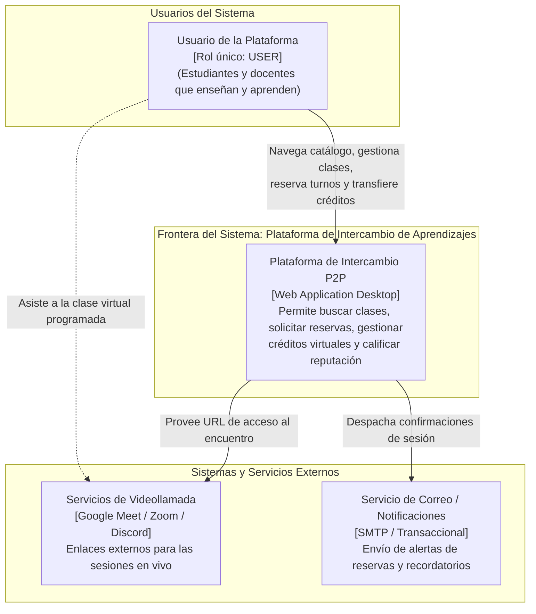
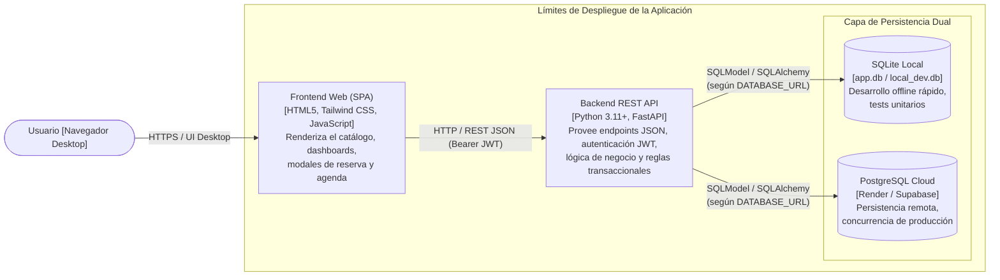
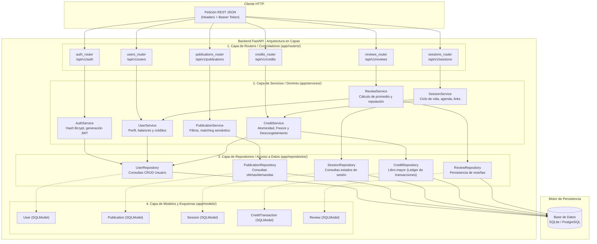
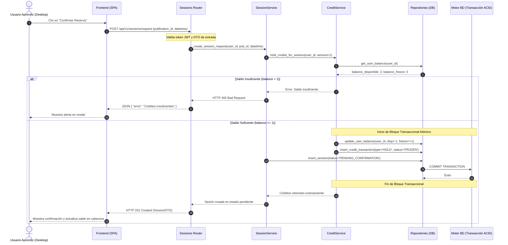

# 4.3.16 Confeccionar el diagrama de arquitectura técnica

## 1. Propósito y Enfoque Metodológico

El presente documento formaliza la **arquitectura técnica de software** de la **Plataforma de Intercambio de Aprendizajes**, correspondiente al entregable **`4.3.16`** de la WBS. Su objetivo es proporcionar una visión estructural exhaustiva, modular y desacoplada del sistema, que sirva de guía para el equipo de desarrollo, facilite la trazabilidad con los requerimientos funcionales del **MVP V3** y garantice el cumplimiento de las restricciones de dominio:
1. **Rol único de usuario (`USER`):** Una sola entidad en la base de datos capaz de ofrecer conocimientos o solicitar aprendizajes indistintamente.
2. **Mecanismo de créditos virtuales no monetarios:** Contabilidad transaccional atómica con custodia temporal preventiva (*freeze*) durante la reserva.
3. **Persistencia dual transparente:** Operación sin fricción en entorno local mediante SQLite y en la nube mediante PostgreSQL.

Para la representación formal se adopta el estándar internacional **Modelo C4** (*Context, Containers, Components, Code*), complementado con el desglose en capas (*Layered Architecture Pattern*) del backend FastAPI.

---

## 2. Nivel 1: Diagrama de Contexto del Sistema (C1)

El diagrama de contexto ilustra la frontera de la plataforma y sus interacciones con los usuarios y servicios externos de soporte.

---

## 3. Nivel 2: Diagrama de Contenedores (C2)

El diagrama de contenedores describe la arquitectura física y de despliegue lógico de las piezas que componen la solución web.

### Detalle de los Contenedores:
* **Frontend Web (Desktop Client):** Aplicación de una sola página (*SPA*) liviana y modular, desacoplada del backend. Consume exclusivamente la API REST mediante contratos JSON tipados, asegurando tiempos de carga inmediatos y validación de formularios en el cliente.
* **Backend REST API (FastAPI):** Servidor asíncrono basado en Starlette y Pydantic. Expone los endpoints agrupados por dominio bajo `/api/v1`, documentados automáticamente mediante Swagger/OpenAPI en `/docs`.
* **Capa de Persistencia Dual (SQLModel):**
  * *Entorno Local:* Base de datos embebida `SQLite` (`sqlite:///./local_dev.db`) con bandera `check_same_thread=False` para ejecución concurrente sin dependencias externas de instalación.
  * *Entorno Nube:* Instancia administrada de `PostgreSQL` inyectada mediante variable de entorno `DATABASE_URL`.

---

## 4. Nivel 3: Diagrama de Componentes y Capas Internas del Backend (C3)

El backend implementa una estricta **Arquitectura en 4 Capas (*Layered Architecture*)** para maximizar el desacoplamiento, la testeabilidad y la mantenibilidad del código:

### Responsabilidades por Capa:
1. **Routers (Controladores):** Reciben las solicitudes HTTP, aplican inyección de dependencias (`Depends(get_db)`, `Depends(get_current_user)`), validan los contratos de entrada/salida (*DTOs/Schemas*) y delegan inmediatamente en los servicios.
2. **Services (Lógica de Negocio):** Orquestan las reglas del sistema (por ejemplo, verificar si el aprendiz tiene créditos disponibles antes de permitir la reserva, coordinar el estado de la sesión y ejecutar la acreditación contable).
3. **Repositories (Acceso a Datos):** Encapsulan todas las consultas a la base de datos utilizando `select`, `where` y operaciones CRUD de SQLModel, aislando el motor de persistencia del resto de la aplicación.
4. **Models (Entidades):** Clases híbridas de SQLModel que funcionan simultáneamente como modelos relacionales de tabla en la base de datos y esquemas de validación Pydantic.

---

## 5. Diagrama de Secuencia: Transacción Crítica con Custodia (*Freeze*)

El siguiente diagrama detalla cómo colaboran las capas del sistema durante la operación más sensible de la plataforma: la solicitud de una clase con retención preventiva de créditos.

---

## 6. Decisiones Clave de Arquitectura (ADRs Sintetizados)

| ID | Título de la Decisión | Alternativas Evaluadas | Decisión Aprobada y Fundamentación |
| :---: | :--- | :--- | :--- |
| **ADR-01** | Framework de Backend | Django, Flask, Express.js | **FastAPI:** Rendimiento asíncrono sobresaliente, soporte nativo de tipos en Python, validación estricta y generación de OpenAPI automática. |
| **ADR-02** | Motor ORM y Persistencia | SQLAlchemy crudo, Tortoise ORM, Peewee | **SQLModel:** Fusión perfecta entre SQLAlchemy y Pydantic desarrollada por Tiangolo; permite soporte dual transparente (SQLite local / PostgreSQL Cloud) sin duplicar clases de modelo y esquema. |
| **ADR-03** | Modelo de Usuarios | Modelo bi-rol (Student/Teacher) vs. Rol Unificado | **Rol Único (`USER`):** Cualquier persona puede enseñar o aprender sin cambiar de perfil ni duplicar sesiones, reflejando el principio pedagógico de intercambio simétrico de la cátedra. |
| **ADR-04** | Gestión Contable de Créditos | Saldo escalar simple vs. Ledger con custodia | **Ledger Transaccional con Freeze:** Evita fraudes o débitos irreversibles. El crédito se retiene preventivamente y solo se transfiere cuando la sesión concluye con conformidad de ambas partes. |

---

## 7. Trazabilidad con la WBS

Este documento materializa el paquete **`4.3.16 Confeccionar el diagrama de arquitectura técnica`** y establece el marco técnico vinculante para los paquetes de desarrollo de la WBS:
* `2.1 Sistema de usuarios`
* `2.2 Sistema de publicaciones`
* `2.4 Solicitudes y sesiones`
* `2.5 Créditos virtuales`
* `3.1 Seguridad y moderación`
