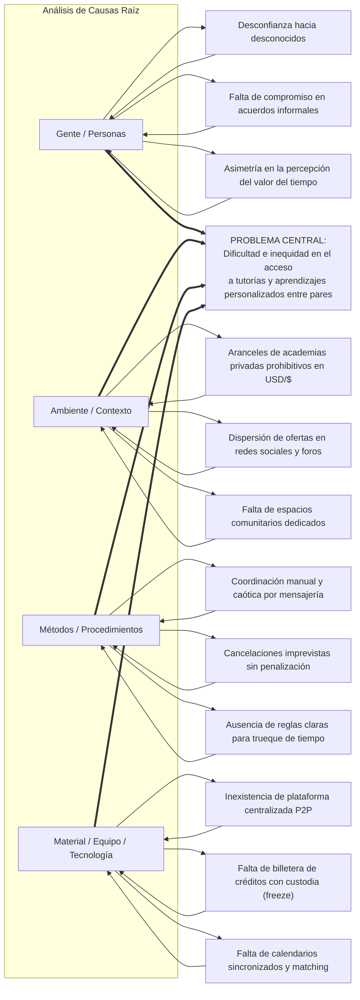

# 4.3.2 Diagrama de Causa y Efecto (Análisis del Problema)

**Entregable WBS:** 4.3.2 Confeccionar el diagrama de causa y efecto / template de análisis del problema  
**Proyecto:** Plataforma de intercambio de aprendizajes  
**Fuente de verdad técnica y de negocio:** [`mvp-v3.md`](../../../proyecto-sdd/docs/mvp-v3.md)  
**Marco metodológico:** Diagrama de Ishikawa (Espina de Pescado) según la cátedra (*Gestión del Desarrollo de Sistemas Informáticos - FIUBA*)  

---

## 1. Diagrama de Ishikawa (Espina de Pescado)

Siguiendo las 4 categorías estándar de la cátedra (**Gente**, **Ambiente**, **Métodos / Procedimientos** y **Material / Equipo**), se desglosan las causas que provocan el problema central:

---

## 2. Matriz de Clasificación de Causas (Espinazo y Espinas)

| Categoría (Espinazo) | Subcategorías / Causas Raíz (Espinas) | Manifestación en la Realidad | Cómo lo neutraliza la Plataforma |
|:---|:---|:---|:---|
| **1. Gente / Personas** | • **Desconfianza interpersonal:** Miedo a enseñar sin recibir nada a cambio. • **Falta de seriedad:** Acuerdos que se disuelven por falta de formalidad. • **Asimetría de expectativas:** Dificultad para valorar si una hora de inglés equivale a una hora de diseño. | La gente prefiere no arriesgar su tiempo con personas desconocidas que no tienen referencias previas. | **Reputación y verificación:** Sistema de calificaciones (1 a 5 estrellas), comentarios públicos de sesiones completadas y perfiles transparentes. |
| **2. Ambiente / Contexto** | • **Barreras económicas:** Tarifas fijas de academias o institutos que excluyen presupuestos justos. • **Informalidad dispersa:** Ofertas aisladas en grupos de WhatsApp o tablones físicos de facultades. | Las personas con ganas de superarse quedan estancadas por no disponer de dinero en efectivo para pagar clases. | **Economía solidaria:** El intercambio se realiza mediante créditos virtuales internos. Nadie paga en dinero; se paga enseñando lo que se domina. |
| **3. Métodos / Procedimientos** | • **Coordinación caótica:** Días de intercambio de mensajes para fijar un día. • **Cancelaciones unilaterales:** La otra parte cancela cinco minutos antes sin costo alguno. • **Falta de reglas de trueque:** ¿Qué pasa si uno enseña hoy pero el otro no puede devolver la clase hasta el mes siguiente? | La coordinación informal frustra a ambas partes y rompe el hábito de aprendizaje. | **Custodia preventiva (freeze):** Los créditos quedan en garantía al aceptar la sesión y se liberan solo tras la confirmación de la clase. Soporte para intercambios diferidos. |
| **4. Material / Equipo (Tecnología)** | • **Falta de plataforma unificada:** No existe un catálogo digital con filtros estructurados. • **Sin motor de compatibilidad:** El usuario debe buscar manualmente entre cientos de publicaciones. • **Inexistencia de agenda sincronizada:** Conflictos de superposición de horarios. | El usuario gasta más tiempo buscando y coordinando que el tiempo efectivo dedicado a la clase. | **Solución integrada:** Motor de búsqueda con detección de intercambios recíprocos, agenda con franjas horarias y control de solapamiento. |

---

## 3. "El Problema Detrás del Problema" (Conclusión del Análisis)

El análisis de Ishikawa demuestra que la verdadera barrera de la educación personalizada no es la escasez de personas capacitadas ni la falta de interés por aprender. 

**La causa raíz fundamental es la ausencia de un medio de cambio y un marco de confianza confiable:**
1. Cuando el dinero es el único medio de cambio, el aprendizaje se vuelve un privilegio de quienes pueden pagarlo.
2. Cuando se intenta hacer trueque directo informal, la doble coincidencia de necesidades (que justo la persona que sabe lo que busco quiera lo que yo sé, y en el mismo horario) y la falta de garantías hacen colapsar la iniciativa.

La **Plataforma de Intercambio de Aprendizajes** soluciona ambos problemas de raíz al introducir una **unidad de cuenta interna (créditos)** que permite el intercambio diferido y multilateral, respaldada por un protocolo tecnológico de **custodia transaccional y reputación verificada**.
