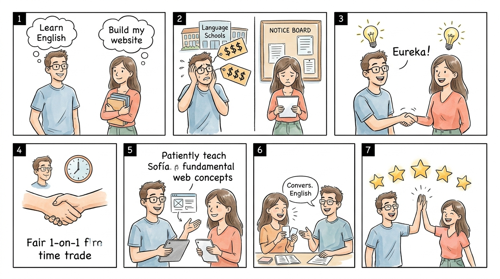

# 4.3.3 Storytelling de la Iniciativa

**Entregable WBS:** 4.3.3 Confeccionar el Storytelling de la iniciativa  
**Proyecto:** Plataforma de intercambio de aprendizajes  
**Fuente de verdad técnica y de negocio:** [`mvp-v3.md`](../../../proyecto-sdd/docs/mvp-v3.md)  
**Marco metodológico:** Estructura de 4 cuadrantes de la cátedra (*Gestión del Desarrollo de Sistemas Informáticos - FIUBA*)  

---

> [!TIP]
> **Artefacto Visual de Diapositiva (Estilo Cátedra TC017):**
> Para la presentación y defensa oral, el recorrido secuencial del Storytelling en 7 momentos se encuentra maquetado en su slide interactiva con zoom y guión del orador:
> 👉 **[Ver Diapositiva Visual de Storytelling (storytelling-slide.html)](file:///c:/develop/95.24/proyecto-wbs/docs/Entrega/storytelling-slide.html)**

---

## Ilustración Integral para Presentación (Storyboard de 7 Viñetas en 1 Slide)

*Archivo de alta resolución listo para insertar en PowerPoint:* [`storyboard-storytelling-7-partes.jpg`](file:///c:/dev/95.24/proyecto-wbs/docs/Entrega/storyboard-storytelling-7-partes.jpg)

---

## 1. Matriz de Storytelling (Estructura de 4 Cuadrantes)

Siguiendo el esquema canónico de Visual Thinking de la cátedra, la historia se articula en cuatro cuadrantes complementarios:

| **Contexto** | **Problema** |
|:---|:---|
| **Martín** (26 años) es desarrollador frontend junior; domina React y CSS, pero necesita aprender inglés conversacional para aplicar a empleos remotos.  **Sofía** (28 años) es traductora pública de inglés; habla fluido pero necesita aprender a crear su propio sitio web profesional para ofrecer sus servicios de traducción.  Ambos tienen conocimientos valiosos para compartir, pero sus presupuestos mensuales son ajustados para pagar academias privadas o profesores particulares en dólares/pesos. | Martín intenta buscar profesor en plataformas tradicionales: las clases cuestan entre \$15 y \$25 USD por hora, dinero del que no dispone.  Sofía intenta recurrir al método tradicional: publica un mensaje en grupos de Facebook y foros de clasificados ofreciendo *“intercambio clases de inglés por clases de computación”*.  **El dolor analógico:** Mensajes perdidos en el feed, falta de coincidencia horaria, personas que no responden, desconfianza mutua y temor a dedicar horas a enseñar sin garantías de que la otra persona cumpla su parte. |
| **Solución** | **Desenlace feliz** |
| Martín y Sofía descubren la **Plataforma de Intercambio de Aprendizajes**.  1. Se registran con su perfil único de `USER`. Martín indica que enseña *Desarrollo Web* y desea aprender *Inglés*. Sofía indica lo inverso. 2. La plataforma les otorga su saldo inicial de créditos de bienvenida. 3. El motor de compatibilidad detecta la **coincidencia temática y horaria recíproca**. 4. Sofía reserva una sesión de desarrollo web con Martín: los créditos quedan en **custodia (freeze preventivo)** garantizando la seguridad de ambas partes. 5. Concluyen la clase por videollamada y confirman la sesión en la app. | **¡Misión cumplida!**  Al confirmar la finalización, los créditos en custodia se transfieren de forma automática al saldo de Martín.  Ambos se califican mutuamente con 5 estrellas y dejan reseñas públicas verificadas.  Con los créditos ganados, Martín reserva su primera clase de inglés conversacional con Sofía.  **Impacto final:** Ambos adquirieron las habilidades que necesitaban sin gastar dinero, generando una red colaborativa confiable basada en créditos y reputación. |

---

## 2. Desarrollo Narrativo de la Experiencia (Guión para Presentación y Defensa)

### Escena 1: Contexto inicial (*"Había una vez..."*)
En el día a día laboral, miles de personas poseen habilidades técnicas, artísticas o de idiomas que podrían enseñar a otros. 

* **Martín** trabaja maquetando pantallas web. Le apasiona la tecnología y sabe enseñar con paciencia, pero su techo profesional está trabado porque no domina el inglés para entrevistas técnicas. Con sus ingresos actuales, pagar un instituto o un tutor privado en moneda extranjera resulta inviable.
* Por otro lado, **Sofía**, traductora de inglés con amplia experiencia pedagógica, necesita con urgencia tener su propio portafolio digital y comprender conceptos básicos de diseño web para captar clientes en internet, pero las cotizaciones que recibe de agencias superan ampliamente lo que puede invertir.

Ambos representan el estatus de partida: dos personas motivadas, con saberes reales y complementarios, pero aisladas y bloqueadas por la barrera del dinero.

---

### Escena 2: El quiebre y el dolor del método tradicional (*"El problema..."*)
Cuando Sofía decide no rendirse, intenta resolverlo con las herramientas a su alcance:
1. Publica en grupos de estudiantes y redes sociales un cartel virtual: *"Ofrezco conversación en inglés a cambio de alguien que me ayude con mi web"*.
2. El cartel queda sepultado por cientos de publicaciones de memes y ofertas de venta.
3. Quienes le responden no tienen horarios compatibles o cancelan a último momento sin aviso.
4. Por su lado, Martín explora plataformas como Superprof o Preply: todas le exigen tarjeta de crédito internacional y tarifas fijas por hora.

**El problema de fondo:** En el mundo tradicional no existe un mecanismo formal para el trueque de conocimientos que sea seguro, sincrónico y con validación de horarios y confianza.

---

### Escena 3: La aparición de la plataforma (*"Hasta que descubrieron la solución..."*)
Un amigo de la facultad le recomienda a Martín la **Plataforma de Intercambio de Aprendizajes**.

1. **Onboarding sin fricción:** Se registra en un minuto. La plataforma maneja un único rol de usuario (`USER`), permitiéndole en el mismo espacio cargar lo que sabe enseñar (*HTML, CSS, Fundamentos Web*) y lo que necesita aprender (*Inglés Conversacional Intermedio*).
2. **Catálogo y Matching inteligente:** El sistema cruza sus franjas de disponibilidad horaria y sus categorías de interés, destacando el perfil de Sofía como *Match Compatible*.
3. **Economía de créditos con custodia:** 
   - La plataforma no utiliza dinero ni transacciones bancarias. Cada usuario recibe créditos iniciales de cortesía.
   - Sofía solicita una clase individual de 1 hora de Maquetación Web con Martín para el jueves a las 18:00 hs.
   - En ese instante, los créditos correspondientes pasan a **estado de custodia (freeze)**: Martín sabe que el compromiso es serio y Sofía sabe que si la clase se cancela a tiempo o no se dicta, sus créditos quedan protegidos y retornan a su cuenta.
4. **Ejecución y confirmación:** El jueves realizan la sesión en vivo. Martín le enseña a estructurar su web. Al finalizar, Sofía presiona *"Confirmar sesión completada"*.

---

### Escena 4: Desenlace feliz (*"Misión cumplida"*)
1. La plataforma liquida automáticamente los créditos retenidos en freeze y se los acredita a Martín en su saldo disponible.
2. Ambos completan el formulario de calificación (puntuación de 1 a 5 estrellas y feedback sobre puntualidad y calidad pedagógica), aumentando su reputación visible en la comunidad.
3. Ahora, Martín usa los créditos que ganó para solicitarle a Sofía su primera clase de conversación en inglés.
4. **Resultado alcanzado:**
   - Martín destrabó su preparación para entrevistas laborales en inglés.
   - Sofía construyó y lanzó su sitio web profesional.
   - La comunidad ganó dos usuarios activos, verificados y con reputación positiva, sin que mediara una sola transacción de dinero tradicional.

---

## 3. Elementos Clave de Trazabilidad con el Proyecto Jira (WBSO) y MVP V3

Este storytelling no es meramente ilustrativo; valida directamente los paquetes de trabajo de la WBS:
- **WBS 2.1 (Sistema de usuarios):** Rol único `USER`, conocimientos que enseña/aprende, saldo visible.
- **WBS 2.3 (Búsqueda y compatibilidad):** Detección de intercambios recíprocos y coincidencias horarias.
- **WBS 2.4 (Solicitudes y sesiones):** Flujo de solicitud, reserva y confirmación de sesión completada.
- **WBS 2.5 (Créditos virtuales):** Regla de freeze/custodia preventiva y liberación por confirmación.
- **WBS 2.7 (Calificaciones y reputación):** Puntuación de 1 a 5 y control de calificaciones duplicadas.
- **WBS 4.2 (Demo en vivo):** Sirve como guion directo para la demo con dos computadoras entre Docente y Alumno.
