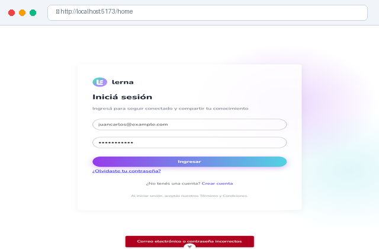
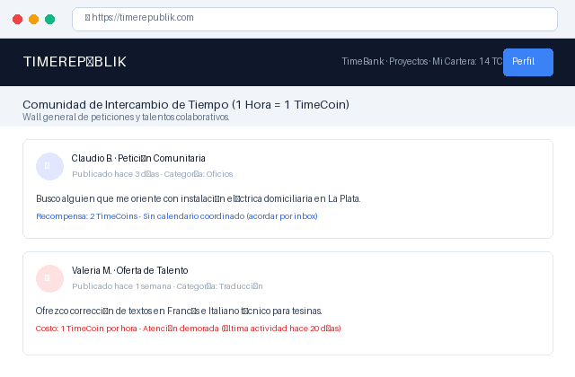
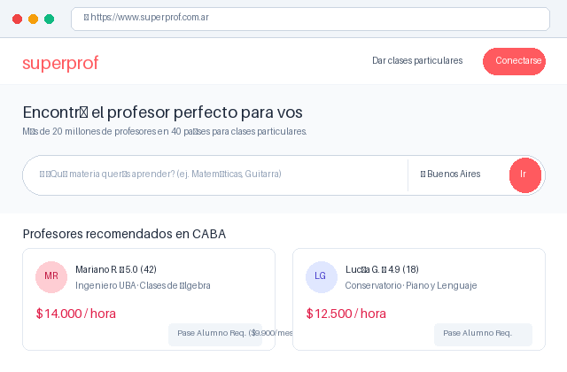
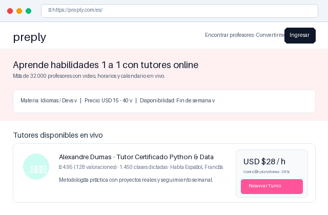
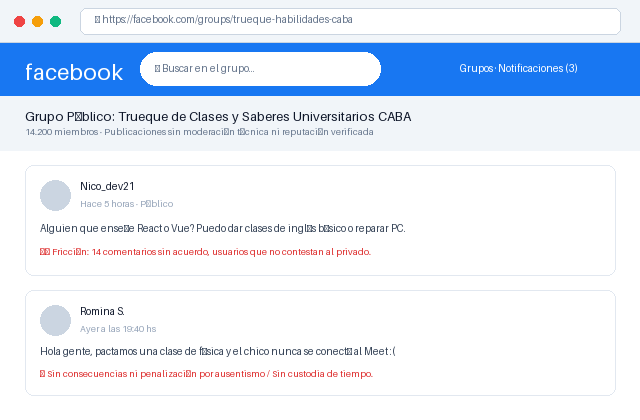

# 4.3.6 - Benchmarking Competitivo de la Iniciativa

**Proyecto:** Plataforma de Intercambio de Aprendizajes y Habilidades (Lerna)  
**Materia:** TC017 - Gestión del Desarrollo de Sistemas Informáticos (FIUBA)  
**Entregable WBS:** `4.3.6` (Bajo la Épica `WBSO-4: Definición de la Iniciativa y Alcance`)  
**Fecha:** Noviembre 2026  

---

> [!TIP]
> **Artefacto Visual de Diapositiva (Estilo Cátedra TC017):**
> Para la defensa y presentación oral del coloquio, la matriz comparativa y las fichas de evaluación se encuentran maquetadas en el slide interactivo oficial:
> 👉 **[Ver Diapositiva Visual de Benchmarking y Scoring (benchmarking-slide.html)](file:///c:/develop/95.24/proyecto-wbs/docs/Entrega/benchmarking-slide.html)**

---

## 1. Introducción y Marco Metodológico

### 1.1 ¿Qué es el Benchmarking?
Conforme al marco conceptual de la cátedra, el **Benchmarking** es el *proceso sistemático y continuo que, mediante una matriz comparativa estandarizada, evalúa los productos, servicios y procesos de organizaciones y plataformas reconocidas como referentes del mercado*.

### 1.2 Objetivos del Análisis
1. **Mitigación de errores de diseño:** Identificar fricciones, barreras de accesibilidad y complejidades innecesarias en plataformas existentes para no replicarlas en **Lerna**.
2. **Adopción de mejores prácticas UX/UI:** Incorporar patrones de interacción destacados (filtros multifacéticos, agendas sincrónicas, notificaciones de turno).
3. **Validación del posicionamiento de valor:** Constatar la ventaja competitiva de Lerna como plataforma **P2P no monetaria basada en créditos de tiempo**, frente a modelos tradicionales arancelados o canales informales de trueque desestructurados.

---

## 2. Tipología y Enfoque Seleccionado

| Tipo de Benchmarking | Enfoque Evaluado | Propuesta de Valor para el Proyecto |
| :--- | :--- | :--- |
| **Competitivo (Adoptado)** | **Competidores directos e indirectos** | **Vital para el posicionamiento de producto y definición del MVP.** |
| **Interno** | Procesos y módulos internos de la solución | Optimización del flujo entre reservas, agenda y libro mayor de créditos. |
| **Genérico** | Estándares universales de interacción digital | Buenas prácticas de diseño responsivo (Tailwind/Shadcn) y accesibilidad WCAG. |
| **Funcional** | Industrias no competidoras (ej. transporte, hotelería) | Adopción del concepto de *custodia preventiva (freeze)* similar a apps como Airbnb o Uber. |

Se aplica un **Benchmarking Competitivo**, contrastando a Lerna con cuatro alternativas representativas del ecosistema formativo y colaborativo.

---

## 3. Criterios de Análisis y Métricas de Scoring

Siguiendo la metodología de evaluación de la cátedra, se establecen **4 criterios de evaluación** ponderados en una escala cuantitativa de **25 a 100 puntos**, totalizando un puntaje máximo de **400 puntos**:

```
+---------------------------------------------------------------------------------------+
| CRITERIOS OFICIALES DE EVALUACIÓN TC017                                              |
|                                                                                       |
|  [👤] Usabilidad (Cualitativa)              -> Heurísticas de Jakob Nielsen (10 reglas)|
|  [👆] Accesibilidad y Navegación (Cuantit.)  -> W3C / WCAG + Responsive + Flujos      |
|  [🛠️] Versatilidad (Cualitativa)            -> Customización + Flexibilidad + Roles   |
|  [🎯] Cantidad de Touchpoints (Cuantitativa) -> Canales de contacto e interacción     |
|                                                                                       |
|  TOTAL SCORE MÁXIMO = 400 PUNTOS                                                      |
+---------------------------------------------------------------------------------------+
```

### 3.1 Usabilidad (Variable Cualitativa)
* **Definición:** Evaluación estandarizada regida según las **10 reglas heurísticas de Jakob Nielsen** (visibilidad del estado del sistema, coincidencia con el mundo real, control y libertad del usuario, consistencia, prevención de errores, reconocimiento antes que recuerdo, flexibilidad, estética minimalista, diagnóstico de errores y ayuda contextual).
* **Escala de Valoración:**
  * **0 - 2 Heurísticas cumplidas:** Malo = **25 puntos**
  * **3 - 5 Heurísticas cumplidas:** Regular = **50 puntos**
  * **6 - 8 Heurísticas cumplidas:** Bueno = **75 puntos**
  * **9 - 10 Heurísticas cumplidas:** Muy Bueno = **100 puntos**

### 3.2 Accesibilidad y Navegación (Variable Cuantitativa)
* **Definición:** Grado de conformidad con los lineamientos de accesibilidad WCAG/W3C (contraste tipográfico, jerarquía semántica, navegación asistida, diseño responsivo sin desbordamiento horizontal y reducción de barreras cognitivas o motoras).
* **Escala de Valoración (según incidencias y problemas detectados):**
  * **Alto volumen de barreras / No responsivo:** Crítico = **25 puntos**
  * **Problemas frecuentes de legibilidad y desborde:** Regular = **50 puntos**
  * **Responsivo con observaciones menores de contraste:** Bueno = **75 puntos**
  * **Diseño responsivo fluido, código semántico y alta legibilidad:** Óptimo = **100 puntos**

### 3.3 Versatilidad (Variable Cualitativa)
* **Definición:** Nivel de flexibilidad, apropiación simbólica y poder de customización que el sistema ofrece al usuario. Evalúa la capacidad de desempeñarse en roles duales (enseñar y aprender simultáneamente), la amplitud de áreas de conocimiento, la gestión de modalidades (virtual y presencial) y las opciones de disponibilidad horaria.
* **Escala de Valoración:**
  * **Esquema rígido unidireccional (sólo alumno o sólo profesor):** Muy Bajo = **25 puntos**
  * **Opciones limitadas de personalización:** Moderado = **50 puntos**
  * **Buena parametrización de materias y modalidades:** Elevado = **75 puntos**
  * **Rol dual USER simétrico, filtros multifacéticos y agenda adaptable:** Excelente = **100 puntos**

### 3.4 Cantidad de Touchpoints (Variable Cuantitativa)
* **Definición:** Puntos de contacto y canales de interacción entre el usuario y la plataforma (notificaciones en tiempo real de solicitudes, recordatorios de agenda, enlaces directos a salas de videollamada, muro de reputación y soporte).
* **Escala de Valoración:**
  * **Canal único estático (contacto por formulario/mail externo):** Escaso = **25 puntos**
  * **2 canales básicos (web + email):** Básico = **50 puntos**
  * **3 canales integrados (web, alertas, mensajería de solicitud):** Completo = **75 puntos**
  * **Touchpoints integrales (web responsiva + agenda + videollamada + reputación + centro de notificaciones):** Superior = **100 puntos**

---

## 4. Relevamiento Individual de Plataformas Competidoras

### 4.1 Lerna (Nuestra Iniciativa)
* **Descripción:** Plataforma comunitaria de intercambio de aprendizajes entre pares (P2P), donde el valor no está mediado por dinero sino por **créditos de tiempo** (1 crédito = 1 hora de dedicación formativa).
* **Captura de Interfaz Relevada:**



* **Fortalezas relevadas:**
  * **Rol unificado USER:** Toda persona puede ofrecer propuestas de lo que sabe y solicitar clases de lo que desea aprender sin bifurcación de cuentas.
  * **Custodia preventiva de créditos (*freeze*):** Garantiza seguridad transaccional al aprendiz y al docente sin riesgo de fraude.
  * **Agenda y encuentros integrados:** Sincronización visual de clases que doy / clases que tomo y acceso con un clic a la videollamada.
  * **Diseño moderno y accesible:** Desarrollado bajo sistema de diseño Tailwind CSS / Shadcn UI con tipografía Inter y navegación lateral persistente.
* **Oportunidades de mejora:**
  * Desarrollo futuro de aplicación móvil nativa (actualmente optimizada como Web Responsiva).

---

### 4.2 TimeRepublik (Banco de Tiempo Global)
* **Descripción:** Red social suiza de banco de tiempo basada en unidades de tiempo ("TimeCoins"). Los miembros ofrecen servicios generales (traducción, carpintería, asesoramiento) y reciben horas para intercambiar.
* **Captura de Interfaz Relevada:**



* **Fortalezas relevadas:**
  * Economía circular consolidada sin dinero fiduciario.
  * Presencia internacional en múltiples idiomas.
* **Debilidades relevadas:**
  * **Usabilidad confusa (Nielsen deficiente):** Interfaz desordenada tipo feed social antiguo, con muros de publicaciones infinitos que dificultan encontrar una clase específica.
  * **Nula sincronización de agenda:** El acuerdo de horarios se realiza por mensajería libre privada sin calendario integrado ni salas de videollamada.
  * **Accesibilidad deficiente:** Pobre contraste en dispositivos móviles y tiempos de carga elevados.

---

### 4.3 Superprof
* **Descripción:** Marketplace líder internacional de profesores particulares para clases presenciales y virtuales en más de 1.000 disciplinas.
* **Captura de Interfaz Relevada:**



* **Fortalezas relevadas:**
  * Buscador y filtros geográficos de excelente nivel.
  * Fichas de docente muy completas con reseñas validadas y badges de verificación.
* **Debilidades relevadas:**
  * **Modelo monetario agresivo y asimétrico:** Exige el pago de un "Pase Alumno" mensual en dinero (\$10.000+ ARS) sólo para habilitar el contacto con el docente.
  * **No existe reciprocidad ni intercambio:** Es una relación mercantil tradicional; quien no dispone de dinero queda excluido de aprender.
  * **Gestión de clases externa:** Tras contactarse, la plataforma no intermedia la custodia del pago ni provee agenda integrada.

---

### 4.4 Preply / Italki
* **Descripción:** Plataformas globales especializadas en clases 1 a 1 de idiomas y habilidades técnicas con docentes particulares.
* **Captura de Interfaz Relevada:**



* **Fortalezas relevadas:**
  * Touchpoints de primer nivel: App nativa iOS/Android, calendario interactivo integrado y aula virtual propia.
  * Alta accesibilidad y estética minimalista.
* **Debilidades relevadas:**
  * **Costos prohibitivos en moneda extranjera:** Clases tasadas en USD fuera del alcance de gran parte de la comunidad estudiantil.
  * **Comisiones extractivas al docente:** La plataforma retiene entre el 18% y el 33% de los honorarios del profesor.
  * **Unidireccionalidad:** Los usuarios son rígidamente clasificados como "Estudiantes" o "Tutores".

---

### 4.5 Comunidades Informales (Grupos de Facebook / Discord / WhatsApp)
* **Descripción:** Canales analógicos o de redes sociales generales donde los estudiantes y vecinos publican solicitudes de trueque de habilidades.
* **Captura de Interfaz Relevada:**



* **Fortalezas relevadas:**
  * Gratuidad total y ausencia de intermediarios comerciales.
* **Debilidades relevadas:**
  * **Caos operativo total:** Publicaciones perdidas en el feed, nula estructuración de temáticas y sin filtros de búsqueda.
  * **Inseguridad y abandono:** No hay validación de reputación ni custodia de compromisos; alto índice de cancelaciones sin aviso.
  * **Cero accesibilidad formal:** Ausencia de herramientas de agenda, cálculo de tiempo o métricas.

---

## 5. Matriz de Scoring Comparativa (Cátedra TC017)

Aplicando las rúbricas oficiales de la cátedra a cada competidor, se consolida la siguiente matriz de puntajes sobre **400 puntos**:

| Marcas / Plataformas Evaluadas | Usabilidad (100 pts) | Accesibilidad y Navegación (100 pts) | Versatilidad (100 pts) | Touchpoints (100 pts) | **SCORE TOTAL (400 pts)** | Posición y Estado |
| :--- | :---: | :---: | :---: | :---: | :---: | :--- |
| 🟢 **Lerna (Iniciativa)** | **100** | **100** | **100** | **75** | **375** | **Líder de Intercambio P2P** |
| 🟡 **Preply / Italki** | 100 | 75 | 75 | 100 | **350** | Fuerte en UX, barrera monetaria |
| 🟡 **Superprof** | 75 | 75 | 75 | 50 | **275** | Excelente catálogo, alta fricción de pago |
| 🟠 **TimeRepublik** | 50 | 50 | 75 | 50 | **225** | Buen concepto de tiempo, UX desactualizada |
| 🔴 **Comunidades Informales** | 25 | 25 | 50 | 25 | **125** | Sin soporte estructurado ni seguridad |

---

## 6. Conclusiones y Aplicación a la Construcción del MVP

El benchmarking valida tres decisiones centrales del desarrollo de **Lerna**:

1. **Eliminación de la barrera monetaria (Superprof/Preply):**  
   Al operar con créditos de tiempo puros (1h = 1 crédito), Lerna democratiza el acceso a la formación sin suscripciones abusivas ni comisiones en dólares.
2. **Superación del caos de las comunidades informales:**  
   La incorporación del **mecanismo de custodia preventiva (*freeze*)** y la **Agenda coordinada** resuelven el ausentismo y la falta de compromiso habitual en el trueque informal.
3. **Rol dual sin fricción frente a la rigidez de la industria:**  
   A diferencia de los marketplaces tradicionales que obligan a crear cuentas separadas de "Docente" y "Alumno", la arquitectura de Lerna unifica ambas capacidades en el rol de dominio **USER**, permitiendo a cualquier miembro publicar propuestas de lo que sabe y solicitar sesiones de lo que necesita aprender.

---

## 7. Trazabilidad con la WBS y Requisitos de Entrega

| Ítem WBS | Denominación del Entregable | Estado | Cobertura en la Solución |
| :--- | :--- | :---: | :--- |
| **`4.3.6.1`** | Definición de Criterios y Rúbricas | Concluido | Adopción de las 4 variables oficiales de la cátedra. |
| **`4.3.6.2`** | Relevamiento de Competidores | Concluido | 4 alternativas representativas del mercado contrastadas. |
| **`4.3.6.3`** | Matriz de Scoring y Hallazgos | Concluido | Ponderación formal sobre 400 puntos y justificación de ventajas. |
| **`4.3.6.4`** | Diapositiva de Exposición | Concluido | Artefacto interactivo [`benchmarking-slide.html`](file:///c:/develop/95.24/proyecto-wbs/docs/Entrega/benchmarking-slide.html). |
