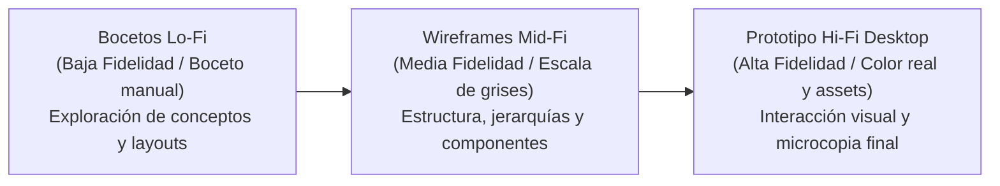

# 4.3.7 Confeccionar el diseño UX y los wireframes

## 1. Propósito y Enfoque Metodológico

El objetivo del diseño de experiencia de usuario (UX) e interfaz (UI) para la **Plataforma de Intercambio de Aprendizajes** es estructurar una navegación intuitiva, transparente y centrada en la interacción entre pares (*Peer-to-Peer*). Dado que en el sistema rige el principio de **rol único de usuario (`USER`)** —donde cualquier integrante puede enseñar o aprender indistintamente mediante créditos virtuales de intercambio—, la interfaz de escritorio (*Desktop Web Application*) prioriza la visibilidad constante de tres elementos críticos:
1. **El saldo de créditos disponible vs. en custodia (*freeze*)**.
2. **La dualidad de acción** ("Quiero Enseñar" vs. "Quiero Aprender").
3. **La trazabilidad de los estados de una sesión** (Solicitada $\rightarrow$ Aceptada $\rightarrow$ Realizada $\rightarrow$ Calificada).

Siguiendo el marco metodológico de la cátedra (*Gestión del Desarrollo de Sistemas Informáticos - TC017 - FIUBA*), el proceso de diseño se articula en tres niveles de fidelidad progresiva:



* **Baja Fidelidad (Lo-Fi):** Bocetos conceptuales iniciales para diagramar la disposición de contenedores, barra superior (*Navbar*), panel de filtros y cuadrículas de contenido.
* **Media Fidelidad (Mid-Fi):** Wireframes estructurales en escala de grises con dimensiones de escritorio estándar (1280px / 1440px), estableciendo la distribución de tarjetas (*cards*), tablas de sesiones, modales de reserva y bloques de funcionalidades clave sin distracciones cromáticas.
* **Alta Fidelidad (Hi-Fi):** Prototipo visual terminado aplicando el *Design Kit* institucional, tipografía calibrada, estados de interacción (*hover, active, disabled*) y fotografías temáticas para cada categoría de aprendizaje.

---

## 2. Design Kit & Sistema de Diseño

Inspirado en los principios de diseño gráfico de la cátedra (claridad, jerarquía visual, contraste accesible WCAG AA y feedback inmediato de estado), se define el siguiente kit visual para la versión web de escritorio:

### 2.1 Paleta de Colores

| Rol del Color | Variante | Código HEX | Muestra | Uso en la Interfaz Desktop |
| :--- | :--- | :--- | :---: | :--- |
| **Primario (Confianza & Aprendizaje)** | *Light* | `#EBF3FA` | 🟦 | Fondos de tarjetas destacadas, badges de categoría activa. |
| | *Main* | `#1E5A8A` | 🟦 | Barra de navegación superior, botones principales (*CTA*), títulos de sección. |
| | *Dark* | `#123755` | 🟦 | Estados hover de botones primarios, pie de página (*Footer*), textos de énfasis. |
| **Secundario (Acción & Intercambio)** | *Light* | `#EAFBF3` | 🟩 | Fondo de saldo de créditos, confirmación de reserva exitosa. |
| | *Main* | `#00B074` | 🟩 | Botones de acción positiva ("Publicar", "Confirmar Sesión", "Liberar Créditos"). |
| | *Dark* | `#008256` | 🟩 | Estados hover en acciones transaccionales. |
| **Escala de Grises (Contraste y Lectura)** | *Background* | `#F8F9FA` | ⬜ | Fondo general del lienzo de la aplicación desktop. |
| | *Borders / Dividers* | `#E2E8F0` | ◽ | Separadores de cuadrículas, bordes de tarjetas y modales. |
| | *Muted Text* | `#64748B` | ◽ | Subtítulos, etiquetas secundarias, metadatos (fecha, modalidad, requisitos). |
| | *Body Text* | `#334155` | ⬛ | Texto corrido de descripciones de publicaciones y notas de sesión. |
| | *Headings* | `#0F172A` | ⬛ | Títulos principales (H1, H2, H3) y nombres de usuario. |
| **Semánticos & Transaccionales** | *Freeze / Custodia* | `#F59E0B` | 🟨 | Badge de créditos en custodia temporal durante una reserva activa. |
| | *Destructivo / Alerta* | `#EF4444` | 🟥 | Botón de cancelación de sesión, alertas de error o saldo insuficiente. |

### 2.2 Tipografía

* **Tipografía Primaria (Títulos y Jerarquías - Display):** `Montserrat` / `Plus Jakarta Sans` (pesos 600 SemiBold y 700 Bold), aportando solidez profesional y legibilidad en pantallas de alta resolución.
* **Tipografía Secundaria (Cuerpo y Componentes - UI):** `Inter` / `System Sans-Serif` (pesos 400 Regular y 500 Medium), optimizada para formularios, tablas de agenda, filtros y modales.

---

## 3. Inventario de Wireframes de Pantalla Desktop y Funcionalidades Clave

A continuación se detalla la estructura visual de las **7 pantallas troncales** que materializan el alcance del **MVP V3**, acompañadas obligatoriamente por sus **funcionalidades clave** conforme a las especificaciones de entrega de la cátedra.

---

### Pantalla 1: Home / Catálogo y Buscador de Aprendizajes (Desktop)

```text
+----------------------------------------------------------------------------------------------------+
|  [LOGO] Plataforma P2P    [Explorar]  [Mis Clases]  [Agenda]        (Saldo: 3 CR | 1 Freeze)  [Perfil] |
+----------------------------------------------------------------------------------------------------+
|                                                                                                    |
|   ¿Qué quieres aprender o enseñar hoy?                                    [ + Publicar Oferta ]    |
|   [ Buscar por tema, tecnología o habilidad...            ] [ Buscar ]     [ + Pedir Aprendizaje ]  |
|                                                                                                    |
|   Filtros:  [Categoría: Todas v]   [Modalidad: Virtual v]   [Nivel: Todos v]   [Máx. Créditos: 2 v] |
|----------------------------------------------------------------------------------------------------|
|  Resultados (24 aprendizajes disponibles)                          Ordenar por: [ Compatibilidad v] |
|                                                                                                    |
|  +------------------------+  +------------------------+  +------------------------+                |
|  | [Tag: PROGRAMACIÓN]    |  | [Tag: IDIOMAS]         |  | [Tag: DISEÑO UI/UX]    |                |
|  | Intro a Python y Data  |  | Conversación Francés B1|  | Fundamentos de Figma   |                |
|  | Instructor: Martín G.  |  | Instructora: Lucía P.  |  | Instructor: Carlos R.  |                |
|  | Modalidad: 100% Online |  | Modalidad: Mixta/Pres. |  | Modalidad: 100% Online |                |
|  | Duración: 60 min       |  | Duración: 45 min       |  | Duración: 90 min       |                |
|  | Calificación: ★ 4.9    |  | Calificación: ★ 5.0    |  | Calificación: ★ 4.8    |                |
|  | Costo: 1 Crédito       |  | Costo: 1 Crédito       |  | Costo: 2 Créditos      |                |
|  |                        |  |                        |  |                        |                |
|  | [ Ver Detalle ]        |  | [ Ver Detalle ]        |  | [ Ver Detalle ]        |                |
|  +------------------------+  +------------------------+  +------------------------+                |
+----------------------------------------------------------------------------------------------------+
```

#### Funcionalidades clave:
* **Exploración dual de catálogo:** Búsqueda libre por palabras clave y filtrado combinado por categoría temática, modalidad (virtual/presencial) y costo en créditos.
* **Indicador de compatibilidad P2P:** Ordenamiento inteligente que destaca publicaciones afines a las habilidades que el usuario actual busca o enseña.
* **Cabecera persistente de saldo:** Visualización en tiempo real del saldo disponible y de los créditos temporalmente retenidos (*freeze*).
* **Acceso rápido a publicación:** Botones destacados para crear tanto ofertas de enseñanza como solicitudes de aprendizaje.

---

### Pantalla 2: Ficha de Detalle del Aprendizaje (Desktop)

```text
+----------------------------------------------------------------------------------------------------+
|  [LOGO] Plataforma P2P    [ < Volver al Catálogo ]                  (Saldo: 3 CR | 1 Freeze)  [Perfil] |
+----------------------------------------------------------------------------------------------------+
|                                                                                                    |
|  <- Columna Izquierda (Contenido 65%) ->             <- Columna Derecha (Acción de Reserva 35%) -> |
|                                                                                                    |
|  [Tag: PROGRAMACIÓN]  Publicado hace 2 días          +--------------------------------------------+|
|  # Introducción práctica a Python y Pandas           | Costo por sesión: 1 Crédito P2P            ||
|                                                      | Modalidad: Virtual (Google Meet / Zoom)    ||
|  Instructor: Martín Gómez (★ 4.9 · 18 clases dadas)  | Duración estimada: 60 minutos              ||
|  "Estudiante de Ingeniería apasionado por datos"     |                                            ||
|                                                      | Tu saldo actual: 3 Créditos                ||
|  ## Lo que aprenderás en este intercambio            | Estado: [Créditos suficientes ✓]          ||
|  - Estructuras de control y sintaxis idiomática.     |                                            ||
|  - Carga y limpieza de datos con Pandas.             | [ Solicitar Sesión de Aprendizaje ]        ||
|  - Creación de gráficos básicos con Seaborn.         | (El crédito quedará en custodia hasta que  ||
|                                                      |  la sesión finalice satisfactoriamente)    ||
|  ## Requisitos previos sugeridos                     +--------------------------------------------+|
|  - Conocimientos básicos de lógica de programación.                                                |
|  - Computadora con Python 3.10+ instalado.           +--------------------------------------------+|
|                                                      | Preguntas frecuentes sobre este tutor      ||
|  ## Reseñas de otros miembros (4)                    | • Disponibilidad: Tardes (Lun a Jue)       ||
|  ★ ★ ★ ★ ★ "Excelente explicación de DataFrames"     | • Idioma: Español nativo                   ||
|  ★ ★ ★ ★ ★ "Puntual y muy paciente para guiar."      +--------------------------------------------+|
+----------------------------------------------------------------------------------------------------+
```

#### Funcionalidades clave:
* **Detalle exhaustivo de la propuesta:** Temario descriptivo, nivel de dificultad, prerrequisitos técnicos y duración prevista.
* **Ficha de reputación del usuario anfitrión:** Calificación promedio por estrellas, cantidad de sesiones impartidas y testimonios cualitativos verificados.
* **Validación previa de solvencia en créditos:** Panel lateral que chequea automáticamente si el usuario cuenta con saldo suficiente antes de iniciar la solicitud.
* **Llamado a la acción (CTA) con aviso de custodia:** Botón de reserva que transparenta el mecanismo de retención preventiva (*freeze*).

---

### Pantalla 3: Modal de Solicitud de Sesión y Retención de Créditos (*Freeze*)

```text
+----------------------------------------------------------------------------------------------------+
|                                                                                                    |
|        +----------------------------------------------------------------------------------+        |
|        |  Solicitar Sesión: Introducción a Python y Pandas                      [ X ]     |        |
|        |----------------------------------------------------------------------------------|        |
|        |  1. Selecciona fecha y franja horaria disponible del tutor:                      |        |
|        |     [ Fecha: 24/11/2026 v ]      [ Horario: 18:00 a 19:00 hs v ]                 |        |
|        |                                                                                  |        |
|        |  2. Mensaje introductorio o temas específicos que deseas abordar:                |        |
|        |     [ Hola Martín! Me gustaría enfocar la clase en análisis de CSVs...         ] |        |
|        |                                                                                  |        |
|        |  3. Resumen de la Transacción P2P:                                               |        |
|        |     • Costo del intercambio:           1 Crédito                                 |        |
|        |     • Saldo actual en billetera:        3 Créditos                                |        |
|        |     • Retención en custodia (Freeze): -1 Crédito                                 |        |
|        |     • Saldo disponible restante:        2 Créditos                                |        |
|        |                                                                                  |        |
|        |  ( ! ) Seguridad: El crédito no se transfiere al tutor de inmediato. Permanecerá |        |
|        |        congelado hasta que ambos confirmen que la clase fue completada.          |        |
|        |----------------------------------------------------------------------------------|        |
|        |  [ Cancelar ]                                    [ Confirmar y Congelar Crédito ]|        |
|        +----------------------------------------------------------------------------------+        |
|                                                                                                    |
+----------------------------------------------------------------------------------------------------+
```

#### Funcionalidades clave:
* **Agenda coordinada de disponibilidad:** Selección de fecha y turno basada en la disponibilidad preconfigurada por el anfitrión.
* **Campo de contexto inicial:** Mensaje para acordar expectativas y temas particulares de la clase.
* **Desglose financiero virtual:** Cálculo transparente del saldo antes y después de aplicar el *freeze*.
* **Confirmación bilateral de custodia:** Cláusula de protección que garantiza la devolución del crédito si la sesión no es aceptada o se cancela con anticipación.

---

### Pantalla 4: Dashboard de Usuario y Billetera de Créditos (Desktop)

```text
+----------------------------------------------------------------------------------------------------+
|  [LOGO] Plataforma P2P    [Explorar]  [Mis Clases]  [Agenda]        (Saldo: 2 CR | 1 Freeze)  [Perfil] |
+----------------------------------------------------------------------------------------------------+
|                                                                                                    |
|  <- Panel de Usuario (30%) ->                        <- Historial & Billetera Virtual (70%) ->    |
|                                                                                                    |
|  +--------------------------------+  +-----------------------------------------------------------+ |
|  | [AVATAR] Gonzalo Ramos         |  | BILLETERA DE CRÉDITOS P2P                                 | |
|  | Rol: Miembro Activo (USER)     |  | Disponible: 2 Créditos   |   En Custodia (Freeze): 1      | |
|  | Reputación: ★ 4.95 (12 reviews) |  +-----------------------------------------------------------+ |
|  |                                |                                                             |
|  | Habilidades que enseño:        |  MOVIMIENTOS DE CRÉDITOS                                    |
|  | • Algoritmos y Estructuras     |  +------------+--------------------+-----------+----------+ |
|  | • SQL y Bases de Datos         |  | Fecha      | Concepto           | Variación | Estado   | |
|  |                                |  +------------+--------------------+-----------+----------+ |
|  | Intereses de aprendizaje:      |  | 20/11/2026 | Reserva Python     | -1 CR     | Freeze   | |
|  | • Francés B1                   |  | 18/11/2026 | Clase SQL dictada  | +1 CR     | Cobrado  | |
|  | • Figma UI                     |  | 14/11/2026 | Bienvenida Sistema | +2 CR     | Acredit. | |
|  |                                |  +------------+--------------------+-----------+----------+ |
|  | [ Editar Perfil y Disponib. ]  |                                                             |
|  +--------------------------------+  + Mis Publicaciones Activas --------------------------------+ |
|                                      | • "Consultas avanzadas en PostgreSQL" (Enseñanza) [Editar]| |
|                                      | • "Busco práctica de conversación Francés" (Demanda)[Edit]| |
|                                      +-----------------------------------------------------------+ |
+----------------------------------------------------------------------------------------------------+
```

#### Funcionalidades clave:
* **Perfil unificado de intercambio:** Exhibición simultánea de habilidades ofrecidas e intereses buscados sin segmentación de roles técnicos.
* **Balance diferenciado de créditos:** Separación explícita entre saldo libremente utilizable y saldo comprometido en reservas en curso.
* **Libro mayor (*ledger*) de movimientos:** Historial auditable de ingresos de créditos por clases dictadas y retenciones por reservas solicitadas.
* **Gestión de publicaciones activas:** Monitoreo y edición de ofertas y demandas vigentes creadas por el usuario.

---

### Pantalla 5: Publicador de Propuesta de Intercambio (Desktop)

```text
+----------------------------------------------------------------------------------------------------+
|  [LOGO] Plataforma P2P    [ < Volver a Mis Clases ]                 (Saldo: 2 CR | 1 Freeze)  [Perfil] |
+----------------------------------------------------------------------------------------------------+
|                                                                                                    |
|   NUEVA PUBLICACIÓN DE INTERCAMBIO                                                                 |
|   Comparte tus conocimientos con la comunidad o solicita el aprendizaje que necesitas.             |
|                                                                                                    |
|   1. ¿Cuál es el propósito de tu publicación?                                                      |
|      ( o ) Quiero Enseñar una habilidad         (   ) Busco Aprender un tema                       |
|                                                                                                    |
|   2. Título de la propuesta:                                                                       |
|      [ Ej: Taller intensivo de Git y GitHub para principiantes                                  ] |
|                                                                                                    |
|   3. Categoría temática:                         4. Modalidad preferida:                           |
|      [ Tecnología y Software         v ]            [ Virtual (Meet / Zoom / Discord)      v ]     |
|                                                                                                    |
|   5. Duración y Valor en Créditos:                                                                 |
|      Duración: [ 60 minutos v ]                  Costo: [ 1 Crédito P2P (Fijo según política) v ]  |
|                                                                                                    |
|   6. Descripción detallada y temario:                                                              |
|      +-------------------------------------------------------------------------------------------+ |
|      | Explicaremos repositorios locales, comandos commit, push, pull y ramas de trabajo...      | |
|      |                                                                                           | |
|      +-------------------------------------------------------------------------------------------+ |
|                                                                                                    |
|   7. Días y horarios tentativos:                                                                   |
|      [x] Lunes  [x] Miércoles  [ ] Viernes      Franja: [ 18:00 a 21:00 hs                      ] |
|                                                                                                    |
|   [ Descartar Borrador ]                                            [ Publicar Propuesta ]         |
+----------------------------------------------------------------------------------------------------+
```

#### Funcionalidades clave:
* **Selector de intención transaccional:** Conmutador directo entre publicación de oferta de enseñanza (*Supply*) o necesidad de aprendizaje (*Demand*).
* **Estandarización de valor:** Fijación transparente de los créditos de intercambio (1 crédito = 1 hora de intercambio estándar) según las reglas del MVP.
* **Configuración de disponibilidad recurrente:** Selección de días y rangos horarios para facilitar el matching sin fricción de coordinación externa.
* **Validación de campos requeridos:** Chequeo en vivo de título, categoría y descripción antes de habilitar el botón de publicación.

---

### Pantalla 6: Agenda y Gestión de Sesiones P2P (Desktop)

```text
+----------------------------------------------------------------------------------------------------+
|  [LOGO] Plataforma P2P    [Explorar]  [Mis Clases]  [Agenda (2)]    (Saldo: 2 CR | 1 Freeze)  [Perfil] |
+----------------------------------------------------------------------------------------------------+
|                                                                                                    |
|   AGENDA DE SESIONES DE INTERCAMBIO                                                                |
|   Pestañas: [ Próximas Sesiones (2) ]   [ Por Confirmar (1) ]   [ Historial Completadas (8) ]      |
|                                                                                                    |
|   +----------------------------------------------------------------------------------------------+ |
|   | SESIÓN CONFIRMADA • MAÑANA A LAS 18:00 HS                                                    | |
|   | Tema: Introducción práctica a Python y Pandas                                                | |
|   | Con: Martín Gómez (Tutor)   |   Modalidad: Virtual   |   Retención actual: 1 Crédito (Freeze)| |
|   | Enlace de videollamada: [ meet.google.com/abc-defg-hij ]                                     | |
|   |                                                                                              | |
|   | Acciones:  [ Copiar Link ]   [ Cancelar Sesión (>24h sin penalidad) ]                       | |
|   +----------------------------------------------------------------------------------------------+ |
|                                                                                                    |
|   +----------------------------------------------------------------------------------------------+ |
|   | SESIÓN EN CURSO / POR FINALIZAR • HOY                                                        | |
|   | Tema: Consultas avanzadas en PostgreSQL                                                      | |
|   | Con: Sofía V. (Alumna)     |   Modalidad: Virtual   |   Crédito a percibir: 1 Crédito         | |
|   | Estado: Sesión realizada en el horario convenido.                                            | |
|   |                                                                                              | |
|   | Acciones:  [ Confirmar Clase y Liberar Crédito ]        [ Informar Inconveniente ]           | |
|   +----------------------------------------------------------------------------------------------+ |
+----------------------------------------------------------------------------------------------------+
```

#### Funcionalidades clave:
* **Pestañas de estado operativo:** Segmentación entre sesiones futuras, solicitudes pendientes de aceptación y sesiones finalizadas para calificación.
* **Integración de enlaces de encuentro:** Acceso directo al link de videollamada (*Google Meet / Zoom*) configurado para la sesión.
* **Gestión de cancelaciones reguladas:** Botón de cancelación con advertencia de tiempos mínimos para descongelar créditos sin penalización.
* **Disparador de liberación de custodia:** Botón bilateral para que el aprendiz certifique la clase recibida, activando la transferencia del crédito al tutor.

---

### Pantalla 7: Calificación y Reseña Post-Sesión (Desktop)

```text
+----------------------------------------------------------------------------------------------------+
|                                                                                                    |
|        +----------------------------------------------------------------------------------+        |
|        |  Calificar Sesión de Intercambio                                       [ X ]     |        |
|        |----------------------------------------------------------------------------------|        |
|        |  Sesión: Introducción práctica a Python y Pandas con Martín Gómez                |        |
|        |  Estado: [ Sesión completada con éxito - 1 Crédito transferido al tutor ✓ ]       |        |
|        |                                                                                  |        |
|        |  1. ¿Cómo calificarías tu experiencia general con este intercambio?              |        |
|        |     ★  ★  ★  ★  ★  (5 / 5 estrellas - Excelente)                                 |        |
|        |                                                                                  |        |
|        |  2. Aspectos destacados (selecciona los que correspondan):                       |        |
|        |     [x] Muy puntual    [x] Dominio del tema    [ ] Material didáctico claro      |        |
|        |     [x] Paciencia al explicar    [ ] Buena conexión y audio                      |        |
|        |                                                                                  |        |
|        |  3. Deja un comentario público para la comunidad:                                |        |
|        |     +--------------------------------------------------------------------------+ |        |
|        |     | Martín explicó con ejemplos de la vida real los DataFrames de Pandas.   | |        |
|        |     | Muy recomendable para quien recién comienza con análisis de datos.       | |        |
|        |     +--------------------------------------------------------------------------+ |        |
|        |----------------------------------------------------------------------------------|        |
|        |  [ Calificar más tarde ]                           [ Enviar Calificación Pública]|        |
|        +----------------------------------------------------------------------------------+        |
|                                                                                                    |
+----------------------------------------------------------------------------------------------------+
```

#### Funcionalidades clave:
* **Valoración numérica (1 a 5 estrellas):** Métrica cuantitativa que alimenta el algoritmo de reputación del usuario.
* **Etiquetas de mérito cualitativo (*Badges*):** Reconocimiento rápido de atributos clave (puntualidad, claridad pedagógica, dominio técnico).
* **Comentario libre moderable:** Reseña pública que brinda contexto cualitativo a los futuros estudiantes del tutor.
* **Cierre definitivo del ciclo de intercambio:** Notificación de cierre que archiva la sesión en el historial y actualiza las métricas del usuario.

---

## 4. Trazabilidad con la WBS y el Backlog

| Pantalla Desktop | Código WBS Vinculado | Historias de Usuario (USM) Cubiertas |
| :--- | :--- | :--- |
| **Pantalla 1: Home / Catálogo y Buscador** | `4.3.7.1`, `4.3.7.2` | `US-01` (Explorar catálogo), `US-02` (Filtros), `US-03` (Búsqueda textual) |
| **Pantalla 2: Ficha de Detalle** | `4.3.7.2` | `US-04` (Ver detalle e instructor), `US-05` (Ver requisitos y opiniones) |
| **Pantalla 3: Modal Reserva & Freeze** | `4.3.7.3` | `US-06` (Solicitud de reserva), `US-07` (Congelamiento / Freeze de crédito) |
| **Pantalla 4: Dashboard & Billetera** | `4.3.7.4` | `US-14` (Ver balance), `US-15` (Historial de movimientos), `US-16` (Mis propuestas) |
| **Pantalla 5: Publicador de Propuesta** | `4.3.7.5` | `US-08` (Publicar oferta enseñanza), `US-09` (Publicar solicitud necesidad) |
| **Pantalla 6: Agenda de Sesiones** | `4.3.7.6` | `US-10` (Aceptar/Rechazar sesión), `US-11` (Sala/Link), `US-12` (Finalizar y liberar) |
| **Pantalla 7: Calificación Post-Sesión** | `4.3.7.7` | `US-13` (Calificar y dejar reseña mutua) |
