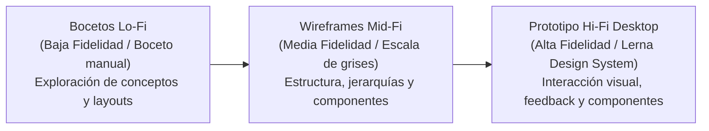

# 4.3.7 Confeccionar el diseño UX y los wireframes

## 1. Propósito y Enfoque Metodológico

El objetivo del diseño de experiencia de usuario (UX) e interfaz (UI) para la **Plataforma de Intercambio de Aprendizajes (Lerna)** es estructurar una navegación intuitiva, transparente y centrada en la interacción entre pares (*Peer-to-Peer*). Dado que en el sistema rige el principio de **rol único de usuario (`USER`)** —donde cualquier integrante puede enseñar o aprender indistintamente mediante créditos virtuales de intercambio—, la interfaz de escritorio (*Desktop Web Application*) prioriza la visibilidad constante de tres elementos críticos:
1. **El saldo de créditos visible y auditado en todo momento** (Disponibles vs. Reservados en custodia preventiva / *freeze*).
2. **La dualidad y alternancia de rol en la misma cuenta** (Pestañas de "Clases que doy" vs. "Clases que tomo" en Agenda y Solicitudes).
3. **La trazabilidad completa del ciclo de vida de una sesión** (Solicitada/Pendiente $\rightarrow$ Aceptada/Confirmada $\rightarrow$ Realizada/Completada $\rightarrow$ Cancelada $\rightarrow$ Calificada).

Siguiendo el marco metodológico de la cátedra (*Gestión del Desarrollo de Sistemas Informáticos - TC017 - FIUBA* en el material teórico de *Wireframing y Prototipado*), el proceso de diseño se articula en tres niveles de fidelidad progresiva:



* **Baja Fidelidad (Lo-Fi):** Bocetos conceptuales iniciales para diagramar la disposición de contenedores, la barra lateral de navegación (*Sidebar*), la barra de estado superior (*Navbar*), el panel de filtros y la cuadrícula de publicaciones.
* **Media Fidelidad (Mid-Fi):** Wireframes estructurales en escala de grises con dimensiones de escritorio estándar (1280px / 1440px), estableciendo la distribución de tarjetas (*cards*), catálogos en dos columnas, modales de reserva, pestañas de gestión de clases y el desglose de saldos sin distracciones ornamentales.
* **Alta Fidelidad (Hi-Fi):** Prototipo visual interactivo implementado en el frontend real (Vue 3 + Vite + Tailwind CSS), aplicando la identidad de marca **Lerna**, degradados característicos (violeta `#7C3AED` a cian `#06B6D4`), tipografía calibrada, estados de interacción (*hover, active, focus, disabled*) y fotografía temática por categoría.

---

## 2. Design Kit & Sistema de Diseño (Lerna UI)

Inspirado en los principios de diseño gráfico y accesibilidad de la cátedra (claridad, jerarquía visual, contraste accesible WCAG AA y feedback inmediato de estado), se define el siguiente kit visual para la aplicación web de escritorio:

### 2.1 Paleta de Colores

| Rol del Color | Código HEX | Muestra | Uso en la Interfaz Desktop |
| :--- | :---: | :---: | :--- |
| **Primario de Marca (Lerna Violet)** | `#7C3AED` | 🟪 | Isotipo, botones de acción principal (*CTA*), bordes de enfoque y acentos de navegación. |
| **Acento de Intercambio (Cyan/Teal)** | `#06B6D4` | 🟦 | Degradados del Hero de bienvenida, botones de navegación secundaria y etiquetas de estado. |
| **Acción Positiva (Success / Green)** | `#00B074` | 🟩 | Botones de aceptación de solicitudes ("Aceptar"), importes positivos en la tabla de créditos y estado activo de publicaciones. |
| **Custodia y Freeze (Warning / Amber)** | `#F59E0B` | 🟨 | Badge de créditos en custodia preventiva temporal durante sesiones pendientes. |
| **Destructivo / Alerta (Danger / Red)** | `#EF4444` | 🟥 | Botón de rechazo o cancelación de sesión, mensajes de error y bajas de créditos. |
| **Lienzo de Fondo (Background)** | `#F8FAFC` | ⬜ | Fondo general del área de trabajo de la aplicación desktop. |
| **Superficie de Tarjetas (Surface)** | `#FFFFFF` | ⬜ | Fondo de contenedores, modales, tarjetas de publicación y paneles de formulario. |
| **Bordes y Divisores (Borders)** | `#E2E8F0` | ◽ | Líneas de división de grillas, contornos de inputs y separadores de tabla. |
| **Texto Principal (Headings & Body)** | `#1E293B` | ⬛ | Títulos (H1, H2, H3), textos de lectura y valores numéricos principales. |
| **Texto Secundario (Muted Text)** | `#64748B` | ◽ | Subtítulos, metadatos (duración, modalidad, nivel) y textos de ayuda en formularios. |

### 2.2 Tipografía

* **Tipografía Primaria (Display y Títulos):** `Montserrat` / `Plus Jakarta Sans` (pesos 600 SemiBold y 700 Bold), para jerarquías visuales contundentes en títulos de pantalla, nombres de cursos y números de balance.
* **Tipografía Secundaria (UI y Textos Corridos):** `Inter` / `System Sans-Serif` (pesos 400 Regular y 500 Medium), optimizada para formularios, filtros laterales, tablas de movimientos y modales.

---

## 3. Shell Global de la Aplicación Desktop

La aplicación opera bajo un diseño estructurado de dos ejes persistentes: una **barra lateral izquierda fija (Sidebar)** y una **barra superior de estado (Header)**.

```text
+----------------------------------------------------------------------------------------------------+
| [ISOTIPO] lerna   |  [Buscador global opcional]                [ 22 ★ ]  [ 🔔 3 ]  [Avatar SR] Sofía R. [Logout] |
+-------------------+--------------------------------------------------------------------------------|
| [🏠 Inicio       ]|                                                                                |
| [🔍 Buscar       ]|                                                                                |
| [📚 Mis clases   ]|                                                                                |
| [✉️ Solicitudes  ]|                           ÁREA DE CONTENIDO PRINCIPAL                           |
| [📅 Agenda       ]|                       (Vistas enrutadas de la aplicación)                      |
| [⏱️ Historial    ]|                                                                                |
| [⭐ Créditos     ]|                                                                                |
| [👤 Mi perfil    ]|                                                                                |
|                   |                                                                                |
| [🚪 Cerrar sesión]|                                                                                |
+-------------------+--------------------------------------------------------------------------------+
```

### Componentes del Shell:
1. **Sidebar lateral (Navegación primaria):**
   * Logotipo e isotipo de marca **Lerna**.
   * 8 accesos directos estructurados: `Inicio` (`/home`), `Buscar` (`/search`), `Mis publicaciones` (`/my-publications`), `Solicitudes` (`/requests`), `Agenda` (`/calendar`), `Historial` (`/history`), `Créditos` (`/credits`), `Perfil` (`/profile`).
   * Botón de cierre de sesión en el pie del panel.
2. **Header superior (Estado y Notificaciones):**
   * **Badge de Saldo de Créditos:** Botón destacado con ícono de estrella y contador numérico en tiempo real (ej. `22 ★`). Al hacer clic navega directamente a `/credits`.
   * **Campana de Notificaciones:** Despliega popover con avisos recientes, botón *"Marcar todas como leídas"* y enlace a *"Ver todas"*.
   * **Perfil del Usuario:** Avatar con iniciales, nombre visible (`Sofía Rossi`) y acceso directo a la configuración de cuenta.

---

## 4. Inventario de Wireframes de Pantalla y Funcionalidades Clave

> [!TIP]
> **Artefacto Visual de Diapositiva (Estilo Cátedra TC017):**
> Para la presentación y defensa oral, los wireframes se encuentran maquetados visualmente en dispositivos móviles lado a lado con sus funcionalidades clave al pie, replicando la plantilla oficial de la cátedra:
> 👉 **[Ver Diapositiva Visual de Wireframes (wireframes-slide.html)](file:///c:/develop/95.24/proyecto-wbs/docs/Entrega/wireframes-slide.html)**
> 👉 **[Ver Diapositiva Visual de Workflows (workflows-slide.html)](file:///c:/develop/95.24/proyecto-wbs/docs/Entrega/workflows-slide.html)**

A continuación se presenta la especificación estructural y el blueprint de las **8 pantallas troncales** de la aplicación, acompañada de sus **funcionalidades clave** conforme al marco de entrega de la materia.

---

### Pantalla 1: Home / Panel de Inicio (`/home`)

#### Blueprint de Estructura y Distribución UI:
| Zona de Pantalla | Componente / Elemento UI | Detalle Visual y Comportamiento |
| :--- | :--- | :--- |
| **Cabecera Shell** | Navbar Superior Fija | Isotipo `lerna`, Badge saldo (`22 ★`), Notificaciones (`🔔`), Avatar usuario (`[SR] Sofía Rossi`). |
| **Sidebar Lateral** | Menú Fijo de Navegación | 8 Accesos: `Inicio (activo)`, `Buscar`, `Mis publicaciones`, `Solicitudes`, `Agenda`, `Historial`, `Créditos`, `Perfil`. |
| **Hero Banner** | Saludo de Bienvenida | Encabezado contextual: *"¡Hola, Sofía! ¿Qué te gustaría aprender o compartir en la comunidad hoy?"* con ilustración P2P. |
| **Métricas KPI** | 3 Tarjetas de Estado Rápido | • **Créditos:** `22 disponibles`<br>• **Solicitudes:** `2 pendientes` (notificación de acción requerida)<br>• **Reputación Docente:** `★ 4.7 / 5.0` |
| **Recomendaciones** | Carrusel de Propuestas | 3 cards: *Pan casero y masa madre (3 CR)*, *Guitarra acústica (1 CR)*, *Inglés técnico IT (1 CR)* con portada, categoría, duración y costo. |
| **Actividad Reciente**| Historial Asistido | Estado vacío asistido con botón de invitación para explorar el catálogo. |

#### Funcionalidades clave:
* **Resumen métrico de arranque:** Visualización en tarjetas del saldo actual de créditos, solicitudes que requieren atención del usuario y reputación como docente.
* **Carrusel inteligente de recomendaciones:** Sugerencias basadas en los intereses de aprendizaje configurados en el perfil del usuario.
* **Acceso rápido al catálogo:** Enlace directo para explorar el buscador completo con filtros avanzados.
* **Tarjeta de publicación sintetizada:** Cada card expone portada, categoría temática, título, duración estimada y costo unitario en créditos.

---

### Pantalla 2: Explorador y Búsqueda de Publicaciones (`/search`)

#### Blueprint de Estructura y Distribución UI:
| Zona de Pantalla | Componente / Elemento UI | Detalle Visual y Comportamiento |
| :--- | :--- | :--- |
| **Cabecera** | Título y Contador | *"Buscador de Aprendizajes"* · Contador dinámico: *"Mostrando 14 publicaciones encontradas"*. |
| **Columna Izquierda (300px)** | Panel Multifacético de Filtros | • **Input textual:** Campo de búsqueda por palabra clave en tiempo real.<br>• **Categorías:** Selectores radio (`Todas`, `Tecnología`, `Cocina`, `Idiomas`, `Música`).<br>• **Nivel:** Dropdown (`Todos`, `Principiante`, `Intermedio`, `Avanzado`).<br>• **Modalidad:** Segmented buttons (`Todas`, `Presencial`, `Virtual`).<br>• **Rango de Créditos:** Slider de 1 a 5 créditos.<br>• **Botón Limpiar Filtros:** Restablece todos los criterios en 1 clic. |
| **Columna Derecha (Grid)** | Catálogo de Tarjetas (3 cols) | Grilla de propuestas con portada, tag de categoría, título, docente, modalidad, tiempo, costo en créditos y botón *"Ver Detalle"*. |
| **Pie de Catálogo** | Paginador | Controles de navegación de páginas `[ < ] [ 1 ] ( 2 ) [ > ]`. |

#### Funcionalidades clave:
* **Filtros multifacéticos combinables:** Búsqueda textual en vivo, selección de categorías temáticas, dropdown de nivel (Principiante, Intermedio, Avanzado) y segmentación por modalidad (Presencial/Virtual).
* **Control deslizante de costo (Slider):** Ajuste de rango máximo y mínimo de créditos para adecuarse al saldo del aprendiz.
* **Paginación eficiente:** Organización del catálogo en lotes manejables con navegación de páginas.
* **Botón de reajuste:** Opción para restablecer todos los filtros a su estado predeterminado en un solo clic.

---

### Pantalla 3: Ficha Detalle de Publicación (`/publications/:id`)

#### Blueprint de Estructura y Distribución UI:
| Zona de Pantalla | Componente / Elemento UI | Detalle Visual y Comportamiento |
| :--- | :--- | :--- |
| **Barra Superior** | Breadcrumb de Retorno | Enlace `[ < Volver a buscar ]` preservando el estado de los filtros anteriores. |
| **Columna Principal (70%)** | Ficha Pedagógica de la Clase | • **Badges:** Categoría temática (ej. `Cocina`) y modalidad (`Presencial`).<br>• **Título:** Nombre de la clase (ej. *"Pan casero y fermentación lenta"*).<br>• **Descripción:** Temario, metodología de enseñanza y materiales requeridos.<br>• **Parámetros:** Nivel sugerido, duración (120 min), cupos e idioma.<br>• **Ubicación:** Dirección y mapa en caso de modalidad presencial.<br>• **Disponibilidad:** Grilla de franjas horarias configuradas por el docente. |
| **Columna Sticky (30%)** | Tarjeta de Acción y Docente | • **Perfil docente:** Avatar, nombre (`Elena Rostova`), reputación (`★ 4.8`) y total de clases dictadas.<br>• **Costo unitario:** `3 Créditos` comparados contra el saldo de la cuenta.<br>• **Botón CTA:** `[ Solicitar Clase ]`.<br>• **Aviso normativo de custodia:** Leyenda explícita: *"Los créditos quedan retenidos en custodia preventiva (freeze) hasta que se confirme y complete la clase"*. |

#### Funcionalidades clave:
* **Desglose completo de propuesta:** Contenidos, requisitos pedagógicos, duración formal y condiciones de dictado.
* **Tarjeta fija de solicitud (Sticky Card):** Muestra el costo en créditos, compara contra el saldo de la cuenta logueada y habilita la acción de reserva.
* **Transparencia transaccional explícita:** Aviso normativo indicando que los créditos no se debitan de inmediato al docente, sino que ingresan en custodia temporal (*freeze*).
* **Selector interactivo de franjas horarias:** Despliegue de los turnos habilitados por el docente para elegir fecha y hora de clase.

---

### Pantalla 4: Mis Publicaciones y Publicador de Clases (`/my-publications`)

#### Blueprint de Estructura y Distribución UI:
| Zona de Pantalla | Componente / Elemento UI | Detalle Visual y Comportamiento |
| :--- | :--- | :--- |
| **Cabecera** | Selector de Modo | Pestañas superiores: `[ (x) Mis publicaciones ]` y `[ ( ) Crear nueva clase ]`. |
| **Resumen Superior** | Métricas de Dictado | 4 Contadores: `Total propuestas (3)`, `Activas (2)`, `Pausadas (1)`, `Alumnos alcanzados (14)`. |
| **Listado de Clases** | Cards de Gestión Docente | Tarjeta por propuesta con título, modalidad, cupos, costo en créditos, **Toggle Switch Activa/Pausada**, botón `✏️ Editar` y botón `🗑️ Eliminar`. |
| **Modo Creador (Pestaña 2)**| Formulario en 5 Pasos | 1. **Datos básicos:** Título y descripción pedagógica.<br>2. **Categorización:** Dropdowns de categoría y nivel.<br>3. **Modalidad:** Radio virtual/presencial con campos de dirección condicionales.<br>4. **Parámetros:** Duración (minutos), cupo máximo y costo en créditos (1 a 5).<br>5. **Horarios:** Días semanales y franjas horarias habilitadas + Botón `[ Publicar Clase ]`. |

#### Funcionalidades clave:
* **Administración de catálogo personal:** Visualización de ofertas vigentes con métricas consolidadas de alumnos alcanzados.
* **Interruptor de estado (Toggle Activa/Pausada):** Permite pausar temporalmente una publicación sin eliminarla cuando el docente no tiene disponibilidad.
* **Formulario estructurado en 5 bloques:** Carga sistemática de título, descripción, modalidad condicional (campos de dirección sólo si es presencial), parámetros y horarios semanales.

---

### Pantalla 5: Gestión de Solicitudes de Clases (`/requests`)

#### Blueprint de Estructura y Distribución UI:
| Zona de Pantalla | Componente / Elemento UI | Detalle Visual y Comportamiento |
| :--- | :--- | :--- |
| **Cabecera** | Pestañas de Estado | 3 Pestañas estrictas: `[ (x) Pendientes (2) ]`, `[ Aceptadas (1) ]`, `[ Canceladas (0) ]`. |
| **Tarjeta de Solicitud**| Ficha Bilateral de Encuentro | • **Identificador:** Código único (ej. `#SOL-104`).<br>• **Contraparte:** Avatar, nombre y handle del alumno/docente (`@gonzadev`).<br>• **Clase asociada:** Título de la propuesta formativa solicitada.<br>• **Fecha y Horario:** Turno exacto propuesto (ej. *Viernes 14/11 - 18:00 a 19:00 hs*).<br>• **Mensaje del solicitante:** Nota personalizada sobre objetivos de aprendizaje.<br>• **Créditos en custodia:** Indicador de saldo comprometido en freeze (`2 CR`). |
| **Botones de Resolución**| Acciones de 1 Clic | Botón verde `[ ✔️ Aceptar Solicitud ]` (pasa a `ACEPTADA` y agenda) y botón neutro `[ ✖️ Rechazar / Cancelar ]` (libera el crédito de inmediato al aprendiz). |

#### Funcionalidades clave:
* **Segmentación estricta por los estados solicitados por la cátedra:** Pestañas separadas para `Pendientes`, `Aceptadas` y `Canceladas`.
* **Detalle contextual del alumno:** Datos del solicitante, mensaje personalizado y validación del turno solicitado.
* **Acciones bilaterales de resolución:** Botón para confirmar y calendarizar la clase, o rechazar la solicitud liberando de inmediato los créditos al comprador.

---

### Pantalla 6: Agenda y Calendario de Clases (`/calendar`)

#### Blueprint de Estructura y Distribución UI:
| Zona de Pantalla | Componente / Elemento UI | Detalle Visual y Comportamiento |
| :--- | :--- | :--- |
| **Selector de Rol** | Contexto de Sesión | Pestañas de doble perspectiva: `[ (x) Clases que doy (Docente) ]` y `[ ( ) Clases que tomo (Alumno) ]`. |
| **Controles de Fecha**| Barra de Navegación Temporal | Selector de mes (`< Noviembre 2026 >`), botón *"Hoy"* y vistas (`Mes`, `Semana`, `Día`). |
| **Matriz Calendario**| Grid Mensual / Semanal | Cuadrícula con días, resaltado de fecha actual y puntos indicadores cromáticos en días con encuentros agendados. |
| **Panel de Turnos** | Detalle del Día Seleccionado | Tarjetas con horario, título de la clase, contraparte, enlace a sala virtual (`meet.google.com/...`), botón `[ Ingresar a la clase ]` y opción de cancelación anticipada (>24h). |

#### Funcionalidades clave:
* **Alternancia de perspectiva en el mismo usuario:** Pestañas separadas para *"Clases que doy"* (enseñanza) y *"Clases que tomo"* (aprendizaje).
* **Navegación temporal dinámica:** Controles mensuales, semanales y botón *"Hoy"*.
* **Panel contextual por día:** Al hacer clic sobre cualquier fecha del calendario, el panel inferior lista los turnos con enlace directo de videollamada y opciones de gestión.

---

### Pantalla 7: Billetera y Movimientos de Créditos (`/credits`)

#### Blueprint de Estructura y Distribución UI:
| Zona de Pantalla | Componente / Elemento UI | Detalle Visual y Comportamiento |
| :--- | :--- | :--- |
| **Métricas de Saldo** | 3 Tarjetas de Billetera | • **Disponibles:** `22 CR` (listos para solicitar clases nuevas).<br>• **Reservados:** `0 CR` (en custodia temporal por solicitudes pendientes).<br>• **Total:** `22 CR` (suma patrimonial de la cuenta). |
| **Aviso Normativo** | Banner Informativo P2P | Recordatorio de regla comunitaria: *"Los créditos son unidades internas de intercambio de tiempo y aprendizaje. No constituyen dinero ni pueden retirarse monetariamente"*. |
| **Libro Mayor** | Tabla de Movimientos Auditables | Columnas: `Fecha`, `Concepto / Clase`, `Monto (+/- CR)`, `Saldo Disponible`, `Saldo Reservado`. |

#### Funcionalidades clave:
* **Diferenciación estricta de saldos:** Tres métricas clave (*Disponibles*, *Reservados en custodia* y *Total*) que responden a la regla de freeze solicitada en la reunión del 5/11.
* **Libro mayor auditable:** Tabla de transacciones con fecha, descripción, impacto de crédito (+ en verde, - en rojo) y saldos parciales.
* **Prohibición de conversión a dinero:** Se explicita en la interfaz que los créditos corresponden a horas de intercambio P2P y no tienen valor monetario ni retiro bancario.

---

### Pantalla 8: Perfil de Usuario y Reputación (`/profile`)

#### Blueprint de Estructura y Distribución UI:
| Zona de Pantalla | Componente / Elemento UI | Detalle Visual y Comportamiento |
| :--- | :--- | :--- |
| **Header de Perfil** | Banner y Avatar | Portada personalizable, foto de perfil, nombre (`Sofía Rossi`), handle (`@sofiadev`) y botón `[ Vista Previa Pública 👁️ ]`. |
| **Navegación Tabulada**| 6 Pestañas de Configuración | `[ Información Personal ]`, `[ Intereses de Aprendizaje ]`, `[ Conocimientos a Enseñar ]`, `[ Disponibilidad Semanal ]`, `[ Preferencias y Ubicación ]`, `[ (x) Mi Reputación ]`. |
| **Muro de Reputación** | Métricas y Reseñas | • **Calificación global:** Promedio `★ 4.7 / 5.0` sobre 3 calificaciones.<br>• **Listado de testimonios:** Reseñas con estrellas, fecha, clase dictada y comentario cualitativo del alumno. |

#### Funcionalidades clave:
* **6 pestañas integrales de configuración:** Datos personales, Intereses de aprendizaje, Conocimientos (habilidades a enseñar y aprender), Disponibilidad horaria semanal, Preferencias de modalidad/ubicación y Reputación.
* **Sistema de reputación transparente:** Promedio numérico con estrellas y lista de testimonios cualitativos asociados a clases concretas.
* **Identidad unificada:** Foto de perfil, biografía y enlace para previsualizar el perfil tal como lo ven los demás aprendices de la comunidad.

---

## 5. Trazabilidad con la WBS y Requisitos de Entrega

| Pantalla Desktop | Código WBS Vinculado | Requisito / Entregable Cubierto |
| :--- | :--- | :--- |
| **Shell Global & Navbar** | `4.3.7.0` | Arquitectura de navegación, saldo visible y centro de alertas |
| **Pantalla 1: Home (`/home`)** | `4.3.7.1` | Dashboard principal, métricas rápidas y publicaciones recomendadas |
| **Pantalla 2: Buscador (`/search`)** | `4.3.7.2` | Búsqueda textual y panel lateral de filtros en dos columnas |
| **Pantalla 3: Detalle (`/publications/:id`)** | `4.3.7.3` | Ficha técnica, sticky action card, slots de horario y aviso de freeze |
| **Pantalla 4: Mis Clases (`/my-publications`)**| `4.3.7.4` | Gestión de propuestas propias con toggle activo/pausado y formulario |
| **Pantalla 5: Solicitudes (`/requests`)** | `4.3.7.5` | Pestañas de estado (Pendientes, Aceptadas, Canceladas) y botones de acción |
| **Pantalla 6: Agenda (`/calendar`)** | `4.3.7.6` | Calendario bimétodo ("Clases que doy" y "Clases que tomo") |
| **Pantalla 7: Créditos (`/credits`)** | `4.3.7.7` | Billetera virtual, saldos (Disponibles vs Reservados) y libro mayor |
| **Pantalla 8: Perfil (`/profile`)** | `4.3.7.8` | Perfil de 6 pestañas, disponibilidad semanal y muro de reputación |
