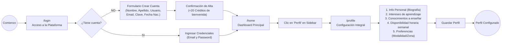
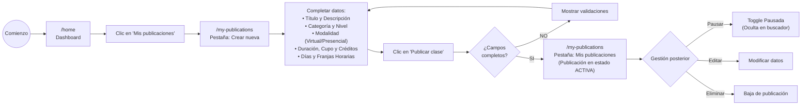
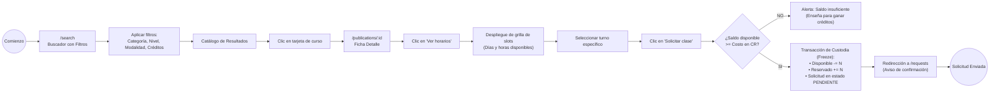
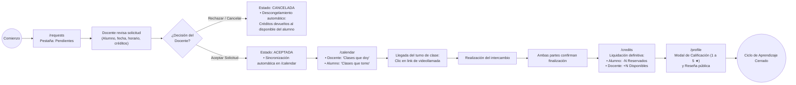

# 4.3.8 Confeccionar los workflows de la aplicación

## 1. Marco Teórico y Notación de los Workflows

Siguiendo el estándar metodológico establecido por la cátedra (*Gestión del Desarrollo de Sistemas Informáticos - TC017 - FIUBA* en el documento de *Wireframing y Prototipado*), los workflows de interacción modelan el recorrido lógico del usuario a través de las pantallas del sistema, especificando de forma rigurosa:
1. **Puntos de inicio y fin del flujo:** Representados por nodos circulares (`Comienzo` / `Fin`).
2. **Pantallas y vistas del sistema:** Rectángulos con bordes redondeados que representan la interfaz visible y su ruta URL real en la aplicación.
3. **Acciones del usuario:** Elementos interactivos destacados (botones, clics o enlaces) que disparan transiciones de estado o navegaciones.
4. **Decisiones y bifurcaciones condicionales:** Nodos en forma de rombo que evalúan reglas de negocio o elecciones del usuario (*¿Tiene cuenta?*, *¿Tiene créditos suficientes?*, *¿Acepta la solicitud?*).

Toda la navegación se rige bajo la regla fundamental de dominio de la plataforma: **rol único `USER`**, donde una misma persona puede alternar entre aprendiz y tutor sin cambiar de cuenta, gestionando el intercambio a través de créditos virtuales con custodia preventiva (*freeze*) y respetando los **4 estados de sesión** acordados (*Pendiente*, *Aceptada*, *Completada*, *Cancelada*).

---

## 2. Diagrama Maestro: Los 4 Flujos Troncales de la Aplicación

```mermaid
flowchart TD
    subgraph F1["Flujo 1: Onboarding, Autenticación y Perfil Integral"]
        direction LR
        S1((Comienzo)) --> P1_Login["/login\nPantalla de Acceso"]
        P1_Login --> D1_Acc{"¿Tiene Cuenta?"}
        D1_Acc -- "NO" --> P1_Reg["Formulario de Registro\n(Datos, Clave, Nacimiento)"]
        P1_Reg --> P1_Cred["Acreditación Bienvenida\n(+20 Créditos)"]
        D1_Acc -- "SI" --> P1_Home["/home\nDashboard de Inicio"]
        P1_Cred --> P1_Home
        P1_Home --> B1_Prof["Sidebar: Mi perfil"]
        B1_Prof --> P1_Prof["/profile\nConfiguración (6 Tabs)"]
        P1_Prof --> S1_End((Perfil Listo))
    end

    subgraph F2["Flujo 2: Publicación y Administración de Clases (Docente)"]
        direction LR
        S2((Comienzo)) --> P2_Home["/home\nDashboard"]
        P2_Home --> B2_MyPub["Sidebar: Mis publicaciones"]
        B2_MyPub --> P2_Pubs["/my-publications\nPestaña: Crear nueva"]
        P2_Pubs --> B2_Fill["Completar datos:\nModalidad, Cupos, Horarios"]
        B2_Fill --> B2_Submit["Botón: Publicar clase"]
        B2_Submit --> D2_Valid{"¿Formulario\nVálido?"}
        D2_Valid -- "SI" --> P2_List["Publicación Activa\n(Toggle Activar/Pausar)"]
        D2_Valid -- "NO" --> P2_Pubs
        P2_List --> S2_End((Clase Visible))
    end

    subgraph F3["Flujo 3: Descubrimiento, Selección de Horario y Reserva con Freeze (Alumno)"]
        direction LR
        S3((Comienzo)) --> P3_Search["/search\nBuscador y Filtros (2 Cols)"]
        P3_Search --> B3_Card["Seleccionar publicación"]
        B3_Card --> P3_Det["/publications/:id\nFicha de Detalle"]
        P3_Det --> B3_Slots["Botón: Ver horarios"]
        B3_Slots --> B3_Pick["Seleccionar turno disponible"]
        B3_Pick --> B3_Req["Botón: Solicitar clase"]
        B3_Req --> D3_Bal{"¿Saldo disponible\n>= Costo?"}
        D3_Bal -- "NO" --> P3_NoCred["Alerta: Saldo insuficiente\n(Enseña para ganar créditos)"]
        D3_Bal -- "SI" --> P3_Hold["Transacción de Custodia:\n• Disponible: -N\n• Reservado: +N"]
        P3_Hold --> S3_End((Solicitud Creada))
    end

    subgraph F4["Flujo 4: Gestión de Solicitud, Agenda, Ejecución y Calificación"]
        direction LR
        S4((Comienzo)) --> P4_Req["/requests\nPestaña: Pendientes"]
        P4_Req --> D4_Accept{"¿Docente\nAcepta?"}
        D4_Accept -- "NO (Rechazar)" --> P4_Cancel["Estado: Cancelada\n• Devolución inmediata de créditos\nal disponible del alumno"]
        D4_Accept -- "SI (Aceptar)" --> P4_Cal["/calendar\nSincronización en Agenda:\n• 'Clases que doy' (Docente)\n• 'Clases que tomo' (Alumno)"]
        P4_Cal --> B4_Join["Día y Hora: Ingreso a clase\n(Link de videollamada)"]
        B4_Join --> B4_Done["Finalizar y Confirmar sesión"]
        B4_Done --> P4_Credits["/credits\nLiquidación Contable:\n• Alumno: -N Reservados\n• Docente: +N Disponibles"]
        P4_Credits --> P4_Rate["/profile\nCalificación y Reseña Pública\n(Estrellas + Testimonio)"]
        P4_Rate --> S4_End((Ciclo Cerrado))
    end
```

---

## 3. Especificación Detallada de cada Flujo

### 3.1 Flujo 1: Onboarding, Autenticación y Perfil Integral

* **Objetivo:** Permitir que un visitante cree su cuenta, acceda a la plataforma, reciba los créditos de bienvenida y complete su perfil integral para estar habilitado a enseñar y aprender.
* **Disparador:** El usuario accede a la URL base de la aplicación (`http://localhost:5173/`).

#### Matriz de Pasos y Pantallas:

| Paso | Pantalla Origen | Acción del Usuario | Decisión / Validación del Sistema | Pantalla Destino |
| :---: | :--- | :--- | :--- | :--- |
| **1.1** | `/login` | Ingresa credenciales o hace clic en "¿No tenés una cuenta? Crear cuenta" | Bifurcación: ¿Tiene cuenta creada? | • Si: Login directo • No: Formulario de Registro |
| **1.2** | `/login` (Registro) | Completa Nombre, Apellido, Usuario, Email, Contraseña y Fecha de nacimiento | Valida unicidad de usuario/email y formato de contraseña. | Redirección a `/home` con acreditación de +20 créditos iniciales |
| **1.3** | `/home` | Observa su saldo inicial en el badge del Header y hace clic en *"Perfil"* en el Sidebar | Carga de datos del usuario autenticado. | `/profile` (Pestaña Información personal) |
| **1.4** | `/profile` | Carga biografía, intereses de aprendizaje y habilidades para enseñar | Validación de campos y categorías seleccionadas. | Pestaña Conocimientos e Intereses |
| **1.5** | `/profile` | Configura su disponibilidad semanal marcando días (Lun a Sáb) y franjas horarias | Guarda matriz de disponibilidad para el motor de matching. | Pestaña Disponibilidad (`/profile`) |

---

### 3.2 Flujo 2: Publicación y Administración de Clases (Docente)

* **Objetivo:** Permitir que un usuario publique una clase para compartir sus conocimientos, definiendo modalidad, cupos, duración, costo en créditos y horarios semanales de dictado.
* **Disparador:** El usuario decide ofrecer un aprendizaje y hace clic en *"Mis publicaciones"* en el Sidebar.

#### Matriz de Pasos y Pantallas:

| Paso | Pantalla Origen | Acción del Usuario | Decisión / Validación del Sistema | Pantalla Destino |
| :---: | :--- | :--- | :--- | :--- |
| **2.1** | `/home` | Clic en *"Mis publicaciones"* en el Sidebar lateral | Carga publicaciones del usuario y métricas. | `/my-publications` |
| **2.2** | `/my-publications` | Hace clic en la pestaña *"Crear nueva"* | Despliega formulario de publicación de clase. | `/my-publications` (Tab Formulario) |
| **2.3** | Formulario de publicación | Completa título, descripción, categoría, nivel y elige modalidad | Si elige Presencial, despliega campos de dirección (Calle, Altura, Ciudad). | Formulario interactivo |
| **2.4** | Formulario de publicación | Configura parámetros (Duración: 60/120 min, Cupo: 1 a 10 alumnos, Costo: 1 a 5 Créditos) y disponibilidad semanal | Valida que el costo en créditos y los cupos sean valores positivos permitidos. | Validación previa |
| **2.5** | Formulario de publicación | Hace clic en *"Publicar clase"* | Almacena la oferta en base de datos e indexa en el catálogo público. | `/my-publications` (Tab Mis publicaciones) con la clase activa |

---

### 3.3 Flujo 3: Descubrimiento de Clase, Selección de Horario y Solicitud con Custodia (*Freeze*)

* **Objetivo:** Facilitar que un aprendiz explore el catálogo de publicaciones, filtre por categoría, nivel o modalidad, consulte los horarios disponibles del docente y envíe una solicitud de clase comprometiendo preventivamente sus créditos.
* **Disparador:** El usuario busca aprender una temática desde `/home` o `/search`.

#### Matriz de Pasos y Pantallas:

| Paso | Pantalla Origen | Acción del Usuario | Decisión / Validación del Sistema | Pantalla Destino |
| :---: | :--- | :--- | :--- | :--- |
| **3.1** | `/search` | Ingresa texto en el buscador o selecciona chips de categorías y modalidad | Ejecuta filtrado reactivo sobre las publicaciones disponibles. | Grilla de resultados (`/search`) |
| **3.2** | Grilla de resultados | Clic en *"Ver Detalle"* sobre la publicación elegida | Carga los datos completos de la clase y el docente. | `/publications/:id` |
| **3.3** | `/publications/:id` | Lee la descripción y hace clic en *"Ver horarios disponibles"* | Consulta los turnos habilitados por el docente. | Grilla interactiva de slots |
| **3.4** | `/publications/:id` | Elige un slot y hace clic en *"Solicitar clase"* | **Validación financiera:** ¿`saldo_disponible >= costo`? | • Si: Procede a custodia • No: Alerta de saldo insuficiente |
| **3.5** | Transacción preventiva | El sistema procesa la solicitud | **Operación atómica de Freeze:** resta del saldo disponible, suma al saldo reservado y genera solicitud en estado `PENDIENTE`. | `/requests` (Pestaña Pendientes) |

---

### 3.4 Flujo 4: Gestión de Solicitud, Agenda, Ejecución y Calificación

* **Objetivo:** Resolver el ciclo de vida completo de la sesión entre docente y alumno: aceptación, agenda coordinada, realización de la clase, liquidación de créditos en custodia y calificación de reputación.
* **Disparador:** El docente recibe la notificación de solicitud o ingresa a `/requests`.

#### Matriz de Pasos y Pantallas:

| Paso | Pantalla Origen | Acción del Usuario | Decisión / Validación del Sistema | Pantalla Destino |
| :---: | :--- | :--- | :--- | :--- |
| **4.1** | `/requests` (Docente) | Visualiza la tarjeta en la pestaña *"Pendientes"* y decide aceptar o rechazar | Bifurcación: ¿Acepta o Rechaza? | • Aceptar: avanza a agenda • Rechazar: cancela y devuelve créditos |
| **4.2** | `/requests` | Si acepta: clic en *"Aceptar Solicitud"* | Cambia estado a `ACEPTADA` y crea evento en `/calendar`. | Pestaña *"Aceptadas"* en `/requests` |
| **4.3** | `/calendar` | Ambos participantes acceden a la agenda en su respectiva pestaña (*"Clases que doy"* / *"Clases que tomo"*) | Exhibe fecha, horario pactado y botón de acceso a videollamada. | `/calendar` |
| **4.4** | Post-clase | Ambos participantes confirman que la clase fue dictada | Valida consentimiento de ambas partes y cambia estado a `COMPLETADA`. | Disparador de liquidación contable |
| **4.5** | `/credits` | Cierre contable de la plataforma | **Liquidación:** Se descuentan definitivamente los créditos retenidos en custodia del alumno y se acreditan al disponible del docente. | Tabla de movimientos en `/credits` |
| **4.6** | `/profile` | El alumno califica la clase (1 a 5 estrellas) y redacta un comentario sobre el desempeño docente | Registra la reseña en la pestaña *"Mi reputación"* del perfil del profesor y recalcula su promedio público. | Perfil público del docente actualizado |

---

## 4. Trazabilidad con la WBS y los Archivos Gráficos del Repositorio

Los workflows detallados en este documento materializan formalmente el entregable **`4.3.8 Confeccionar los workflows de la aplicación`** (hijo de la tarea `WBSO-151` dentro de la épica `WBSO-4`) y guardan directa correspondencia con los artefactos gráficos y de entrega del repositorio:

* **Documento de especificación de wireframes y pantallas:** [`proyecto-wbs/docs/Entrega/4.3.7-diseno-ux-y-wireframes.md`](file:///c:/dev/95.24/proyecto-wbs/docs/Entrega/4.3.7-diseno-ux-y-wireframes.md)
* **Lámina interactiva visual de presentación (idéntica a la diapositiva de la cátedra):** [`proyecto-wbs/docs/Entrega/workflows-slide.html`](file:///c:/develop/95.24/proyecto-wbs/docs/Entrega/workflows-slide.html)
* **Diagrama interactivo en SVG/HTML:** [`proyecto-wbs/docs/workflow-frontend.html`](file:///c:/develop/95.24/proyecto-wbs/docs/workflow-frontend.html)
* **Captura general del flujo:** [`proyecto-wbs/docs/workflow-frontend.png`](file:///c:/dev/95.24/proyecto-wbs/docs/workflow-frontend.png)
* **Diagramas individuales exportables:**
  * Flujo 1: [`proyecto-wbs/docs/workflow_flujo_1.png`](file:///c:/dev/95.24/proyecto-wbs/docs/workflow_flujo_1.png)
  * Flujo 2: [`proyecto-wbs/docs/workflow_flujo_2.png`](file:///c:/dev/95.24/proyecto-wbs/docs/workflow_flujo_2.png)
  * Flujo 3: [`proyecto-wbs/docs/workflow_flujo_3.png`](file:///c:/dev/95.24/proyecto-wbs/docs/workflow_flujo_3.png)
* **Archivo de diseño editable:** [`proyecto-wbs/docs/workflow-frontend.drawio`](file:///c:/dev/95.24/proyecto-wbs/docs/workflow-frontend.drawio)
* **Material teórico de referencia de la cátedra:** [`proyecto-wbs/documentos/Entrega/Material/clase-wireframing-y-prototipado.pdf`](file:///c:/dev/95.24/proyecto-wbs/documentos/Entrega/Material/clase-wireframing-y-prototipado.pdf)
