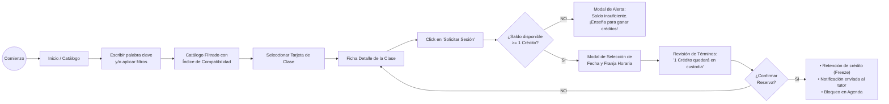

# 4.3.8 Confeccionar los workflows de la aplicación

## 1. Marco Teórico y Notación de los Workflows

Siguiendo el estándar metodológico establecido por la cátedra (*Gestión del Desarrollo de Sistemas Informáticos - TC017 - FIUBA* en el caso de estudio de Prototyping), los workflows de interacción modelan el recorrido lógico del usuario a través de las pantallas del sistema, especificando de forma inequívoca:
1. **Puntos de inicio y terminación:** Representados por nodos circulares (`Comienzo` / `Fin`).
2. **Pantallas y vistas del sistema:** Rectángulos con bordes redondeados que representan la interfaz visible por el usuario en cada etapa.
3. **Acciones del usuario:** Elementos interactivos destacados (botones, enlaces o clics) que disparan transiciones entre pantallas.
4. **Decisiones y bifurcaciones condicionales:** Nodos en forma de rombo que evalúan reglas del sistema o elecciones del usuario (*¿Tiene cuenta?*, *¿Tiene saldo suficiente?*, *¿Confirma la clase?*).

Toda la interacción del sistema se rige bajo la regla fundamental de dominio: **rol único `USER`**, donde el mismo usuario navega alternativamente como aprendiz o como tutor según la actividad, interactuando a través de créditos virtuales de intercambio con mecanismo de custodia preventiva (*freeze*).

---

## 2. Diagrama Maestro: Los 3 Flujos Troncales de la Plataforma

```mermaid
flowchart TD
    subgraph F1["Flujo 1: Onboarding y Publicación de Aprendizaje"]
        direction LR
        S1((Comienzo)) --> P1_Land["Ingreso a la Plataforma"]
        P1_Land --> B1_Acc["acceder"]
        B1_Acc --> P1_Auth["Pantalla Login / Registro"]
        P1_Auth --> D1_Acc{"¿Tiene Cuenta?"}
        D1_Acc -- "NO" --> P1_Reg["Pantalla de Registro"]
        P1_Reg --> P1_Home["Ir a Inicio / Dashboard"]
        D1_Acc -- "SI" --> P1_Home
        P1_Home --> B1_Pub["+ Crear Propuesta"]
        B1_Pub --> P1_Form["Formulario de Propuesta\n(Enseñar o Aprender)"]
        P1_Form --> D1_Save{"¿Desea publicar?"}
        D1_Save -- "SI" --> P1_Cat["Propuesta activa en Catálogo"]
        D1_Save -- "NO" --> P1_Home
    end

    subgraph F2["Flujo 2: Búsqueda, Matching y Reserva con Freeze"]
        direction LR
        S2((Comienzo)) --> P2_Home["Inicio / Catálogo"]
        P2_Home --> B2_Exp["explorar clases"]
        B2_Exp --> P2_Cat["Catálogo + Buscador"]
        P2_Cat --> B2_Find["buscar tema / filtro"]
        B2_Find --> P2_Res["Resultados de Búsqueda"]
        P2_Res --> B2_Sel["seleccionar clase"]
        B2_Sel --> P2_Det["Ficha Detalle"]
        P2_Det --> B2_Sol["solicitar sesión"]
        B2_Sol --> D2_Bal{"¿Tiene créditos\ndisponibles?"}
        D2_Bal -- "NO" --> P2_Err["Alerta: Saldo insuficiente\n(Enseña para ganar créditos)"]
        D2_Bal -- "SI" --> P2_Mod["Modal Reserva + Freeze"]
        P2_Mod --> D2_Conf{"¿Confirmar reserva?"}
        D2_Conf -- "SI" --> P2_Ok["Crédito retenido (Freeze)\nSesión Agendada"]
        D2_Conf -- "NO" --> P2_Det
    end

    subgraph F3["Flujo 3: Realización de Sesión, Liberación y Calificación"]
        direction LR
        S3((Comienzo)) --> P3_Notif["Notificación de Sesión"]
        P3_Notif --> P3_Agen["Agenda de Sesiones"]
        P3_Agen --> B3_Join["ingresar a clase (link)"]
        B3_Join --> P3_Room["Sala Virtual / Encuentro"]
        P3_Room --> B3_End["finalizar clase"]
        B3_End --> D3_Ok{"¿Clase realizada\ncon éxito?"}
        D3_Ok -- "SI" --> P3_Rel["Liberación de Créditos\n(+1 CR al tutor)"]
        D3_Ok -- "NO" --> P3_Disp["Soporte / Mediación"]
        P3_Rel --> P3_Rate["Pantalla de Calificación\n(Estrellas + Review)"]
        P3_Rate --> B3_Sub["enviar reseña"]
        B3_Sub --> S3_End((Fin de Ciclo))
    end
```

---

## 3. Especificación Detallada de cada Flujo

### 3.1 Flujo 1: Darse de alta y configurar propuesta de intercambio

* **Objetivo:** Permitir que un visitante no registrado cree su cuenta, obtenga los créditos iniciales de cortesía y publique su primera oferta de enseñanza o solicitud de aprendizaje.
* **Disparador:** El usuario ingresa a la URL principal de la plataforma desde su navegador de escritorio.

```mermaid
flowchart LR
    A((Comienzo)) --> B["Landing Page"]
    B --> C["Click en 'Registrarse'"]
    C --> D["Pantalla Login/Registro"]
    D --> E{"¿Tiene cuenta?"}
    E -- "SI" --> F["Ingresar Credenciales"]
    E -- "NO" --> G["Completar Formulario\n(Nombre, Email, Contraseña)"]
    G --> H["Acreditación de Bienvenida\n(+2 Créditos P2P)"]
    F --> I["Inicio / Dashboard"]
    H --> I
    I --> J["Click en '+ Publicar'"]
    J --> K["Formulario de Propuesta\n(Seleccionar Enseñar/Aprender)"]
    K --> L["Rellenar datos:\nTítulo, Categoría, Modalidad, Horarios"]
    L --> M{"¿Confirmar\npublicación?"}
    M -- "SI" --> N["Publicación guardada\ny visible en Catálogo"]
    M -- "NO" --> I
```

#### Matriz de Pasos y Pantallas:

| Paso | Pantalla Origen | Acción del Usuario | Decisión / Validación del Sistema | Pantalla Destino |
| :---: | :--- | :--- | :--- | :--- |
| **1.1** | Landing Page pública | Clic en botón "Acceder / Registrarse" | Ninguna (acceso público). | Pantalla Login / Registro |
| **1.2** | Pantalla Login / Registro | Ingreso de credenciales o click en "¿No tienes cuenta? Regístrate" | Bifurcación: ¿Tiene cuenta creada? | • Si: Login directo • No: Pantalla de Registro |
| **1.3** | Pantalla de Registro | Completa Nombre, Email institucional, Contraseña y acepta términos | Validación de formato de email y fortaleza de clave. | Dashboard de Usuario con asignación de +2 créditos iniciales |
| **1.4** | Dashboard de Usuario | Clic en botón superior "+ Publicar" | Valida que el usuario tenga el perfil activo. | Formulario de Nueva Propuesta |
| **1.5** | Formulario de Propuesta | Selecciona "Quiero Enseñar", completa título, categoría, temario y disponibilidad | Validación de campos obligatorios completos. | Diálogo de Confirmación |
| **1.6** | Diálogo de Confirmación | Clic en "Publicar Propuesta" | Persistencia en base de datos; indexación en buscador. | Catálogo Público / Mis Propuestas Activas |

---

### 3.2 Flujo 2: Buscar propuesta, verificar matching y reservar con custodia (*Freeze*)

* **Objetivo:** Facilitar que un aprendiz localice una clase de su interés, compruebe que cuenta con saldo suficiente, reserve una fecha y hora, y active la retención preventiva (*freeze*) de su crédito en la plataforma.
* **Disparador:** El usuario busca aprender una nueva tecnología o habilidad desde el catálogo de la plataforma.

#### Matriz de Pasos y Pantallas:

| Paso | Pantalla Origen | Acción del Usuario | Decisión / Validación del Sistema | Pantalla Destino |
| :---: | :--- | :--- | :--- | :--- |
| **2.1** | Home / Catálogo General | Ingresa texto en el buscador (ej: "Python") y filtra por "Virtual" | Consulta full-text y ordenamiento por reputación y compatibilidad. | Resultados de Búsqueda |
| **2.2** | Resultados de Búsqueda | Clic sobre la tarjeta del aprendizaje deseado | Carga asíncrona de datos del tutor y reseñas. | Ficha Detalle del Aprendizaje |
| **2.3** | Ficha Detalle del Aprendizaje | Revisa temario, requisitos y hace clic en "Solicitar Sesión" | Validación de saldo: ¿`saldo_disponible >= 1`? | • Si: Modal de Reserva • No: Alerta de saldo insuficiente |
| **2.4** | Modal de Reserva | Elige fecha y hora dentro del calendario disponible del tutor y escribe nota previa | Valida que el turno no esté ya reservado por otro usuario. | Resumen de Transacción y Freeze |
| **2.5** | Resumen de Transacción | Clic en "Confirmar y Congelar Crédito" | **Transacción atómica de custodia:** `saldo_disponible -= 1`, `saldo_freeze += 1`. Registro en estado `PENDING`. | Pantalla de Éxito / Redirección a Agenda |

---

### 3.3 Flujo 3: Realización de la sesión, liberación automática de créditos y calificación mutua

* **Objetivo:** Guiar a ambos participantes durante la ejecución del encuentro de aprendizaje, certificar el cumplimiento de la clase, liberar el crédito retenido a favor del tutor y registrar la calificación de reputación.
* **Disparador:** Llegada del día y horario pactado para la sesión de intercambio.

```mermaid
flowchart LR
    A((Comienzo)) --> B["Notificación / Recordatorio"]
    B --> C["Agenda de Sesiones"]
    C --> D["Click en 'Unirse a la clase'\n(Link de Meet/Zoom)"]
    D --> E["Desarrollo de la Clase\nentre Tutor y Aprendiz"]
    E --> F["Conclusión del tiempo\nde intercambio"]
    F --> G["Pantalla Agenda / Detalle de Sesión"]
    G --> H{"¿Clase realizada\ncon normalidad?"}
    H -- "NO (Problemas/Ausencia)" --> I["Apertura de Ticket / Mediación\n(Crédito congelado en revisión)"]
    H -- "SI (Conforme)" --> J["Click en 'Confirmar y Liberar Créditos'"]
    J --> K["Transacción de Liberación:\n• Aprendiz: -1 Freeze\n• Tutor: +1 Crédito Disponible"]
    K --> L["Modal Calificar Sesión\n(1 a 5 estrellas + etiquetas + review)"]
    L --> M["Click en 'Enviar Calificación'"]
    M --> N["Actualización de Reputación Pública\ny Archivo en Historial"]
    N --> O((Fin de Ciclo))
```

#### Matriz de Pasos y Pantallas:

| Paso | Pantalla Origen | Acción del Usuario | Decisión / Validación del Sistema | Pantalla Destino |
| :---: | :--- | :--- | :--- | :--- |
| **3.1** | Email / Notificación en App | Clic en "Ir a la sesión programada" | Verifica que la sesión esté en estado `CONFIRMED`. | Agenda de Sesiones |
| **3.2** | Agenda de Sesiones | Clic en botón "Unirse a la clase" | Abre enlace externo de videollamada (*Google Meet / Zoom*). | Sala de Videollamada (Externa) |
| **3.3** | Agenda de Sesiones (Post-clase) | Clic en botón "Confirmar finalización de la clase" | Validación de consentimiento: ¿Hubo reclamos o cancelaciones? | • Si normal: Liberación de créditos • Si disputa: Mediación |
| **3.4** | Transacción Automática | El backend ejecuta el cierre contable virtual | **Liquidación:** Se descuenta 1 del saldo en custodia del alumno y se incrementa en 1 el saldo disponible del tutor. | Modal de Calificación |
| **3.5** | Modal de Calificación | Asigna puntaje de 1 a 5 estrellas, selecciona etiquetas de mérito (ej: *Puntualidad*, *Claridad*) y redacta comentario | Valida que la calificación esté en rango de 1 a 5. | Cierre de ciclo y confirmación de reputación |
| **3.6** | Dashboard / Historial | El usuario visualiza la sesión cerrada y el impacto en sus estadísticas | Recalcula el promedio de estrellas del tutor e inserta la reseña pública. | Dashboard de Usuario |

---

## 4. Trazabilidad con la WBS y los Archivos Gráficos Existentes

Los flujos definidos en este documento reflejan fielmente el entregable de la WBS **`4.3.8 Confeccionar los workflows de la aplicación`** y se encuentran materializados visualmente en los siguientes artefactos del repositorio:

* **Diagrama interactivo completo en SVG/HTML:** [`proyecto-wbs/docs/workflow-frontend.html`](file:///c:/dev/95.24/proyecto-wbs/docs/workflow-frontend.html)
* **Captura general del flujo:** [`proyecto-wbs/docs/workflow-frontend.png`](file:///c:/dev/95.24/proyecto-wbs/docs/workflow-frontend.png)
* **Diagramas individuales por flujo:**
  * Flujo 1: [`proyecto-wbs/docs/workflow_flujo_1.png`](file:///c:/dev/95.24/proyecto-wbs/docs/workflow_flujo_1.png)
  * Flujo 2: [`proyecto-wbs/docs/workflow_flujo_2.png`](file:///c:/dev/95.24/proyecto-wbs/docs/workflow_flujo_2.png)
  * Flujo 3: [`proyecto-wbs/docs/workflow_flujo_3.png`](file:///c:/dev/95.24/proyecto-wbs/docs/workflow_flujo_3.png)
* **Archivo de diseño editable:** [`proyecto-wbs/docs/workflow-frontend.drawio`](file:///c:/dev/95.24/proyecto-wbs/docs/workflow-frontend.drawio)
