# Estructura de desglose del trabajo (WBS)

**Entregable WBS:** 4.3.9 Confeccionar la WBS (Work Breakdown Structure)  
**Proyecto:** Plataforma de intercambio de aprendizajes  
**Origen:** estructura vigente del proyecto Jira WBSO  
**Fecha de derivación:** 2026-11-11  
**Marco teórico:** WBS orientada a entregables (*Gestión del Desarrollo de Sistemas Informáticos - FIUBA*)  

---

## 1. Marco Conceptual (según la cátedra)

* **Definición:** Herramienta jerárquica que descompone la totalidad del alcance del proyecto en entregables más pequeños, independientes y estimables (regla del 100%).
* **Criterio de partición:** **Basada en entregables y resultados finales**, consolidando los desarrollos técnicos de backend y frontend en paquetes funcionales únicos orientados al valor del producto.
* **Niveles de jerarquía:**
  - **Nivel 0:** Proyecto global (*Plataforma de Intercambio de Aprendizajes*).
  - **Nivel 1:** Módulos principales / Macro-entregables (1. Producto y diseño, 2. Funcionalidad de la plataforma, 3. Seguridad y administración, 4. Entrega y gestión).
  - **Nivel 2:** Componentes funcionales e hitos.
  - **Nivel 3:** Paquetes de trabajo (Work Packages) e historias de usuario estimables.

---

## 2. Diagrama Jerárquico de la WBS (Vista de Módulos)

```mermaid
graph TD
    P["0. Plataforma de Intercambio de Aprendizajes"] --> M1["1. Producto y diseño"]
    P --> M2["2. Funcionalidad de la plataforma"]
    P --> M3["3. Seguridad y administración"]
    P --> M4["4. Entrega y gestión"]

    M1 --> M11["1.1 Planificación y definición MVP"]
    M1 --> M12["1.2 Gestión, despliegue e integración"]

    M2 --> M21["2.1 Sistema de usuarios"]
    M2 --> M22["2.2 Sistema de publicaciones"]
    M2 --> M23["2.3 Búsqueda y compatibilidad"]
    M2 --> M24["2.4 Solicitudes y sesiones"]
    M2 --> M25["2.5 Créditos virtuales"]
    M2 --> M26["2.6 Sistema de historial"]
    M2 --> M27["2.7 Calificaciones y reputación"]
    M2 --> M28["2.8 Sistema de notificaciones"]

    M3 --> M31["3.1 Seguridad y moderación"]
    M3 --> M32["3.2 Panel de administración"]

    M4 --> M41["4.1 Paquete de pruebas"]
    M4 --> M42["4.2 Demo y presentación"]
    M4 --> M43["4.3 Documentación de entrega"]
    M4 --> M44["4.4 Retrospectiva"]
```

---

## 3. Desglose Completo de Paquetes de Trabajo (Jira WBSO Consolidado)

- **1 Producto y diseño**
  - **1.1 Planificación y definición del MVP**
    - **1.1.1 Redacción de la especificación del MVP**
    - **1.1.2 Elaboración de la WBS**
    - **1.1.3 Elaboración del User Story Map**
    - **1.1.4 Elaboración del backlog**
    - **1.1.5 Creación, configuración y carga de épicas, historias y tareas en el tablero de Jira**
    - **1.1.6 Política de contenidos permitidos**
    - **1.1.7 Casos de uso**
  - **1.2 Gestión, despliegue e integración de la plataforma**
    - **1.2.1 Asunción de la responsabilidad y liderazgo del proyecto**
    - **1.2.2 Investigación, selección y configuración del hosting público gratuito y despliegue del frontend**
    - **1.2.3 Investigación, selección y configuración del hosting público gratuito y despliegue del backend**
    - **1.2.4 Integración de los despliegues con el código fuente**
- **2 Funcionalidad de la plataforma**
  - **2.1 Sistema de usuarios**
    - **2.1.1 Módulo de registro**
    - **2.1.2 Módulo de inicio y cierre de sesión**
    - **2.1.3 Recuperación de contraseña**
    - **2.1.4 Perfil de usuario**
    - **2.1.5 Registro de conocimientos que puede enseñar**
    - **2.1.6 Registro de conocimientos que desea aprender**
    - **2.1.7 Configuración de nivel**
    - **2.1.8 Configuración de modalidad**
    - **2.1.9 Configuración de disponibilidad horaria**
    - **2.1.10 Visualización del saldo de créditos**
  - **2.2 Sistema de publicaciones**
    - **2.2.1 Formulario de publicación**
    - **2.2.2 Catálogo de categorías**
    - **2.2.3 Descripción del aprendizaje ofrecido**
    - **2.2.4 Selección del nivel**
    - **2.2.5 Selección de modalidad**
    - **2.2.6 Duración estimada**
    - **2.2.7 Valor en créditos**
    - **2.2.8 Gestión de publicaciones**
    - **2.2.9 Validación de contenido**
  - **2.3 Sistema de búsqueda y compatibilidad**
    - **2.3.1 Buscador de aprendizajes**
    - **2.3.2 Filtros de búsqueda**
    - **2.3.3 Resultados de búsqueda**
    - **2.3.4 Vista de perfiles compatibles**
    - **2.3.5 Motor de compatibilidad basado en reglas**
    - **2.3.6 Detección de coincidencias horarias**
    - **2.3.7 Detección de intercambios recíprocos**
  - **2.4 Sistema de solicitudes y sesiones**
    - **2.4.1 Formulario de solicitud**
    - **2.4.2 Gestión de solicitudes recibidas**
    - **2.4.3 Gestión de solicitudes enviadas**
    - **2.4.4 Estados de las solicitudes**
    - **2.4.5 Agenda de sesiones**
    - **2.4.6 Gestión de fechas y horarios**
    - **2.4.7 Registro de modalidad**
    - **2.4.8 Confirmación de sesión completada**
    - **2.4.9 Control de superposición de horarios**
    - **2.4.10 Analizar los casos de clase cancelada o con fecha vencida**
    - **2.4.11 Analizar los estados de sesión y la cancelación por ambas partes**
  - **2.5 Sistema de créditos virtuales**
    - **2.5.1 Saldo de créditos**
    - **2.5.2 Asignación inicial de créditos**
    - **2.5.3 Reserva de créditos**
    - **2.5.4 Transferencia de créditos**
    - **2.5.5 Cancelación de movimientos**
    - **2.5.6 Historial de créditos**
    - **2.5.7 Registro de intercambios recíprocos**
    - **2.5.8 Restricción de conversión a dinero**
    - **2.5.9 Definir la custodia y devolución de créditos al cancelar una clase**
  - **2.6 Sistema de historial**
    - **2.6.1 Historial de solicitudes**
    - **2.6.2 Historial de sesiones**
    - **2.6.3 Historial de conocimientos enseñados**
    - **2.6.4 Historial de conocimientos aprendidos**
    - **2.6.5 Historial de movimientos de créditos**
    - **2.6.6 Historial de calificaciones**
    - **2.6.7 Agregar un filtro para clases cobradas o completadas**
  - **2.7 Sistema de calificaciones y reputación**
    - **2.7.1 Formulario de calificación**
    - **2.7.2 Puntuación de 1 a 5**
    - **2.7.3 Comentarios sobre las sesiones**
    - **2.7.4 Calificación promedio**
    - **2.7.5 Reputación visible en el perfil**
    - **2.7.6 Control de calificaciones duplicadas**
    - **2.7.7 Validación de sesión completada**
  - **2.8 Sistema de notificaciones**
    - **2.8.1 Notificación de nueva solicitud**
    - **2.8.2 Notificación de aceptación o rechazo**
    - **2.8.3 Notificación de cancelación**
    - **2.8.4 Notificación de modificación de horario**
    - **2.8.5 Recordatorio de sesión**
    - **2.8.6 Notificación de transferencia de créditos**
    - **2.8.7 Notificación de nueva calificación**
  - **2.9 Mostrar las unidades de medida en la plataforma**
  - **2.10 Preparar datos creíbles para la demo**
- **3 Seguridad y administración**
  - **3.1 Sistema de seguridad y moderación**
    - **3.1.1 Categorías de aprendizaje permitidas**
    - **3.1.2 Lista de palabras y expresiones prohibidas**
    - **3.1.3 Filtro de publicaciones**
    - **3.1.4 Sistema de denuncias**
    - **3.1.5 Registro de denuncias**
    - **3.1.6 Protección de datos personales**
    - **3.1.7 Control de acceso y permisos**
    - **3.1.8 Términos y condiciones**
  - **3.2 Panel de administración**
    - **3.2.1 Gestión de usuarios**
    - **3.2.2 Gestión de publicaciones**
    - **3.2.3 Gestión de denuncias**
    - **3.2.4 Gestión de cuentas suspendidas**
    - **3.2.5 Gestión de categorías**
    - **3.2.6 Gestión de palabras prohibidas**
    - **3.2.7 Registro de decisiones administrativas**
- **4 Entrega**
  - **4.1 Paquete de pruebas**
    - **4.1.1 Pruebas funcionales**
    - **4.1.2 Pruebas de integración**
    - **4.1.3 Pruebas de seguridad**
    - **4.1.4 Pruebas de compatibilidad**
    - **4.1.5 Pruebas de usabilidad**
    - **4.1.6 Pruebas de aceptación**
    - **4.1.7 Registro de errores corregidos**
  - **4.2 Demo**
    - **4.2.7 Presentación y demostración del MVP**
    - **4.2.8 Acondicionar el repositorio y preparar los reportes de Git**
    - **4.2.9 Preparar dos computadoras para la demo en vivo**
    - **4.2.10 Preparar el replay de una reserva anticipada y su cancelación**
  - **4.3 Documentacion**
    - **4.3.1 Confeccionar la narrativa de la iniciativa**
    - **4.3.2 Confeccionar el diagrama de causa y efecto del problema**
    - **4.3.3 Confeccionar el Storytelling de la iniciativa**
    - **4.3.4 Confeccionar el Scope Canvas de la iniciativa**
    - **4.3.5 Confeccionar la documentación de User Research**
    - **4.3.6 Confeccionar el Benchmarking**
    - **4.3.7 Confeccionar el diseño UX y los wireframes**
    - **4.3.8 Confeccionar los workflows de la aplicación**
    - **4.3.9 Confeccionar la WBS**
    - **4.3.10 Confeccionar el User Story Map**
    - **4.3.11 Confeccionar el Product Backlog**
    - **4.3.12 Confeccionar el detalle de las historias de usuario**
    - **4.3.13 Confeccionar el detalle de los sprints y el Release Planning**
    - **4.3.14 Confeccionar el reporte de estimaciones**
    - **4.3.15 Confeccionar la matriz de riesgos**
    - **4.3.16 Confeccionar el diagrama de arquitectura**
  - **4.4 Retrospectiva del equipo**

## Criterios de consolidación

- Cada índice WBS aparece una sola vez.
- Las variantes Backend y Frontend se integran en un único paquete de trabajo.
- Se excluyen elementos sin numeración WBS.
- La estructura conserva los nombres funcionales y la relación jerárquica vigente en Jira al momento de la derivación.
